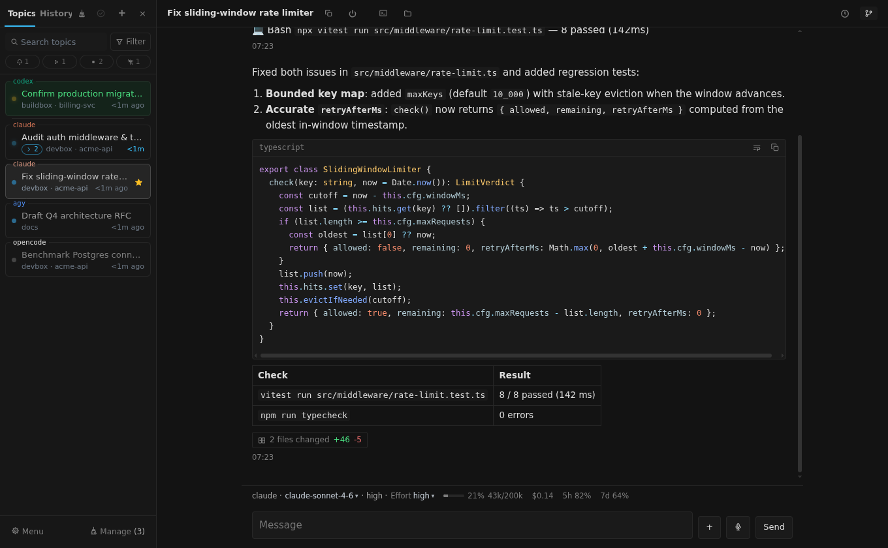
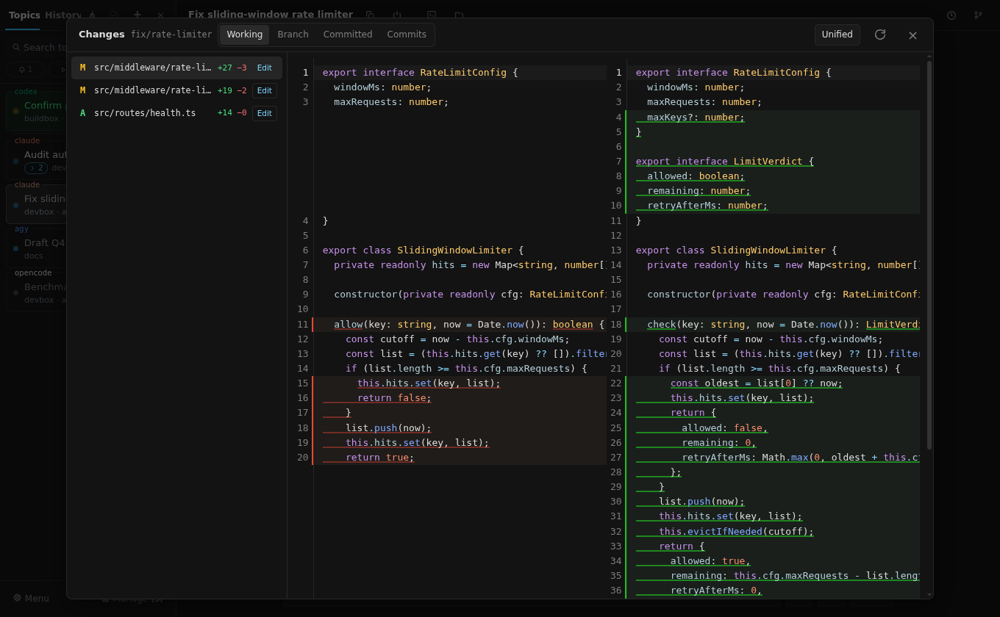
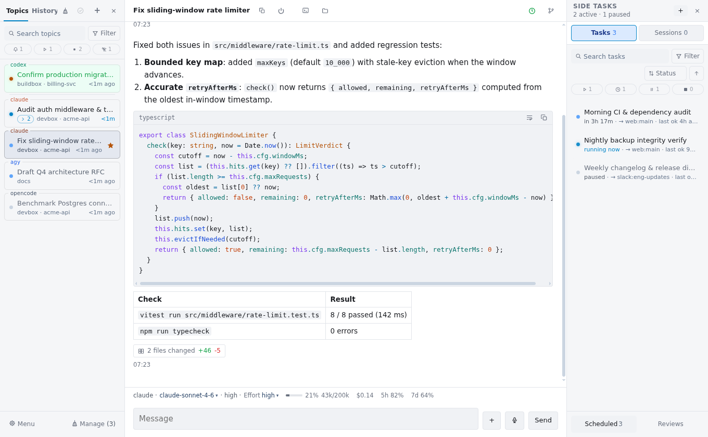

<div align="center">

# fleetherd

**One gateway for the coding agents on all your machines — from its own web workbench or eight chat apps.**

[](https://github.com/noir017/fleetherd/actions/workflows/ci.yml)
[](LICENSE)

English | [简体中文](README.zh-CN.md)

</div>

**fleetherd** is a self-hosted gateway daemon that connects coding agents — Claude Code, Codex, OpenCode, Antigravity, or any [ACP](https://agentclientprotocol.com) / TCP `connect` agent — running locally or across remote Linux hosts over SSH (`pod.yaml`) to a full-featured browser workbench and eight chat platforms. Split work across parallel sub-agents with `/super`, share skills and standing instructions across every machine, and expose controlled gateway tools to external web agents over MCP.

It began as a fork of [l0ng-ai/agent-anywhere](https://github.com/l0ng-ai/agent-anywhere), was called `agent-anywhere` until 2.0.0 and `talkcode` until 3.0.0; the `talkcode` CLI still works as an alias.



<p align="center"><sub>Built-in web workbench — no chat platform required. The same conversations work across Telegram, Discord, Slack, Lark, and more.</sub></p>

| Git Changes & Inline Diff Review | Light Theme & Side Tasks Panel |
| :---: | :---: |
|  |  |

```text
Web UI · Discord · Telegram · Slack · Lark · QQ · LINE · WeCom · DingTalk   External MCP
                                     │                                           │
                                     ▼                                           │
                       ┌───────────────────────────┐                             │
     ┌────────────────►│         fleetherd         │◄────────────────────────────┘
     │                 │  routing · sessions · i18n│
     │                 │  skills · schedules · push│
     │                 └─────────────┬─────────────┘
     │                               │ SSH (pinned keys) or TCP connect
     │         ┌─────────────────────┼─────────────────────┐
     │         ▼                     ▼                     ▼
     │ ┌───────────────┐     ┌───────────────┐     ┌───────────────┐
     │ │ this machine  │     │ devbox (ssh)  │     │ buildbox(ssh) │
     │ │ cc · oc · agy │     │ pod.yaml · cc │     │ cx · connect  │
     │ └───────┬───────┘     └───────┬───────┘     └───────┬───────┘
     └─────────┴─────────────────────┴─────────────────────┘   fleetherd CLI / MCP
       tasks · skills · schedule · send-file · ask · sessions
```

## Features

### Entry points & web workbench

- **Built-in web workbench** — dark/light/system themes, `en` / `zh-CN` UI, token or SSO auth, PWA & Web Push notifications when an agent needs you. Inspect **Git changes** (working tree, branch, commits, inline diff comments), browse and edit remote files in **CodeMirror 6**, view per-turn file diffs, open a docked **terminal**, and manage **Settings**, **Instructions**, **Skills**, **History**, and **Side tasks** in one place. [→](docs/web-ui.md)
- **Eight chat platforms, one daemon** — Discord, Telegram, Slack, Lark/Feishu, QQ, LINE, WeCom, and DingTalk, with multi-account support. [→](docs/platforms.md)
- **Fast voice dictation & transcription** — OpenAI-compatible STT (e.g. Groq Whisper) paired with a dedicated cleanup LLM (or Gemini multimodal); dictate straight into the Web UI composer via 24 kbps Opus WebM, or confirm transcribed voice messages in chat apps. [→](docs/voice.md)

### Many machines, many agents

- **Any ACP, polling, or `connect` agent** — Claude Code, Codex, OpenCode, Antigravity, `custom` commands, mailbox-relayed polling agents ([→](docs/mailbox.md)), and persistent TCP `connect` agents with automatic mid-turn reconnect; routed by platform, channel, user, or command. [→](docs/agents.md)
- **Per-agent controls & telemetry** — live permission levels (`plan`, `ask`, `edits`, `auto`, `full`), custom `quotaCommand` + `/usage`, agent-specific status bar options (e.g. account/effort pickers), context/cost meters, and inline images in agent replies. [→](docs/agents.md)
- **Remote hosts over SSH** — run agents on any Linux host over a pinned SSH link, declare host-local agents in `pod.yaml`, opt into a pod-to-pod SSH mesh, survive network drops, and switch machines with `/agent`. [→](docs/remote-hosts.md)
- **Parallel sub-agents & autonomous review** — `/super <job>` splits work across child topics in parallel (with configurable confirmation tiers, `--model` / `--option` selection, and `task-send --forward`) and supports `--review-by` worker↔reviewer loops without waking the coordinator. [→](docs/sub-agents.md)
- **External MCP entrance** — expose a bearer-authenticated HTTP MCP endpoint to external web agents: read-only `skills`/`sessions` and card-gated `tasks` by default, `agents:` direct topic attachment, or opt-in `trusted: true` mode for full 7-tool gateway parity. [→](docs/external-mcp.md)

### Shared memory & automation

- **Self-evolving skill library** — agents create, version, and revert shared skills synced to every host and harness (with optional Git repo sync); an optional reviewer agent automatically distills quiet conversations into skill updates and preference suggestions. [→](docs/skills.md)
- **Unified standing instructions** — write global rules (`common.md`) and per-agent layers once; delivered to every host and editable from the Web UI settings page. [→](docs/instructions.md)
- **Scheduled tasks** — cron or one-shot agent prompts and cross-host bash commands that survive restarts, managed from chat or the Side tasks panel. [→](docs/scheduled-tasks.md)
- **Searchable conversation archive** — every turn is indexed in local SQLite (FTS5); search via `fleetherd sessions`, 8-character short topic IDs, or one-click reference copy in the Web UI. [→](docs/conversation-history.md)

### Day to day

- **Native streaming & rich rendering** — in-place edits, live tool-call bubbles, syntax-highlighted code blocks with Wrap/Copy, task lists, wide tables, and lifecycle reactions.
- **Non-blocking workflow** — mid-turn messages join the running turn; `/btw` asks a side question without interrupting; `/fork` branches a topic from its current state; `/stop` and `/kill` control execution. [→](docs/chat-commands.md)
- **Topics as workspaces** — each topic binds its own agent, `/cd` working directory, and automatic title; idle agent processes are reclaimed and resumed seamlessly, and failed turns can auto-continue or trigger alerts. [→](docs/working-directory.md)
- **Full i18n & zero-downtime reload** — `en` / `zh-CN` across the Web UI, chat menus, notifications, and CLI; live config edits via [`/setting`](docs/settings.md) and hot reload via `SIGHUP` / `fleetherd reload`. [→](docs/configuration.md)

## Quick start

Requires **Node.js ≥ 22**. fleetherd is not published to npm — install the tarball from the [latest GitHub Release](https://github.com/noir017/fleetherd/releases/latest) (replace `X.Y.Z` with the release version):

```bash
npm install -g https://github.com/noir017/fleetherd/releases/download/vX.Y.Z/fleetherd-X.Y.Z.tgz

fleetherd setup    # interactive wizard: platform, credentials, agent
fleetherd doctor   # self-check
fleetherd start    # open the web UI or message your bot
```

`harness: claude` reuses this machine's `claude /login` session — no API key needed for personal use. For containerized deployments, see [Running in a container](docs/docker.md).

<details>
<summary><strong>Or let your coding agent set it up</strong></summary>

Paste into Claude Code (or any coding agent):

```text
Set up https://github.com/noir017/fleetherd for me: install the CLI
from the latest GitHub release's fleetherd-X.Y.Z.tgz (npm i -g <its URL>;
it is not on npm), then follow the skill bundled in the installed
package (skill/SKILL.md, under `npm root -g`/fleetherd) to configure
and start it.
```

</details>

Minimal `~/.config/fleetherd/config.yaml` (Web UI + one local agent):

```yaml
version: 1
platforms:
  web:
    type: webui
    token: ${WEB_TOKEN}       # login secret; ${VAR} also reads <configDir>/.env
agents:
  - id: claude
    harness: claude
    cwd: ~/projects
routing:
  default: claude
access:
  allowFrom: ["web:owner"]
```

Then open `http://<host>:8787`. See [Configuration](docs/configuration.md) for multi-platform, multi-agent, and remote-host setups.

> [!WARNING]
> Agents run with full tool access by default unless restricted via `permissions` (`plan` / `ask` / `edits`). An empty `access.allowFrom` allows anyone who can reach the bot to run commands on your machine — always populate it in shared deployments. The Web UI binds plain HTTP on `0.0.0.0` by default; read [Exposing it](docs/web-ui.md#exposing-it) before exposing it outside a private network.

## Documentation

| | |
|---|---|
| **Entry points** | |
| [Web UI](docs/web-ui.md) | themes, i18n, Git changes, file editor, terminal, settings, SSO, push |
| [Platforms](docs/platforms.md) | capabilities and quirks of all eight chat platforms |
| [Voice messages](docs/voice.md) | OpenAI/Gemini STT, cleanup LLM, Web UI composer dictation |
| **Many machines, many agents** | |
| [Agents](docs/agents.md) | harnesses, `connect` TCP agents, permissions, `quotaCommand`, turn hooks |
| [Agents that only poll](docs/mailbox.md) | mailbox relay for polling-only harnesses |
| [Remote hosts](docs/remote-hosts.md) | SSH hosts, `pod.yaml`, pod mesh, offline resilience |
| [Sub-agents](docs/sub-agents.md) | `/super`, parallel child topics, `--review-by` loops, confirmation tiers |
| [Callers from outside](docs/external-mcp.md) | external HTTP MCP entrance, `sessions`, `agents:`, `trusted` mode |
| [Running in a container](docs/docker.md) | gateway-only Docker image (`ghcr.io/noir017/fleetherd`) & host wrapper |
| **Shared & automated** | |
| [Skills the gateway keeps](docs/skills.md) | shared skill library, Git sync, versioning, auto-review |
| [Your instructions](docs/instructions.md) | global & per-agent standing instructions and Web UI editor |
| [Scheduled tasks](docs/scheduled-tasks.md) | cron/one-shot prompts & bash jobs across hosts |
| [Past conversations](docs/conversation-history.md) | SQLite FTS5 archive, `fleetherd sessions`, short IDs |
| **Day to day** | |
| [Chat commands](docs/chat-commands.md) | `/new`, `/fork`, `/btw`, `/stop`, `/kill`, `/model`, `/effort`, `/usage` |
| [Working directory](docs/working-directory.md) | `/cd`: one topic per project |
| [Topic names](docs/topic-names.md) | `/title` and automatic naming |
| [Settings from chat](docs/settings.md) | `/setting` & Web UI settings page without restarting |
| [Configuration](docs/configuration.md) | full `config.yaml` reference, `locale`, `.env`, `SIGHUP` reload, CLI |
| [What the agent can do](docs/agent-actions.md) | reverse CLI, native MCP tools, inline images, button questions |

## Contributing

[AGENTS.md](AGENTS.md) holds the conventions, layering rules, testing policy, and security invariants, plus the FRAS codebase map and per-module docs ([config](src/config/README.md) · [core](src/core/README.md) · [platform](src/platform/README.md) · [daemon](src/daemon/README.md) · [ipc](src/ipc/README.md) · [commands](src/commands/README.md)). Start there before changing code.

## License

[MIT](LICENSE)

This project began as a fork of [l0ng-ai/agent-anywhere](https://github.com/l0ng-ai/agent-anywhere) at `3d855f8`, and the original architecture — the platform profile seam in particular — is still recognisable underneath. It has grown a long way past that point since. The upstream MIT copyright notice is retained in [LICENSE](LICENSE), which covers both codebases.
