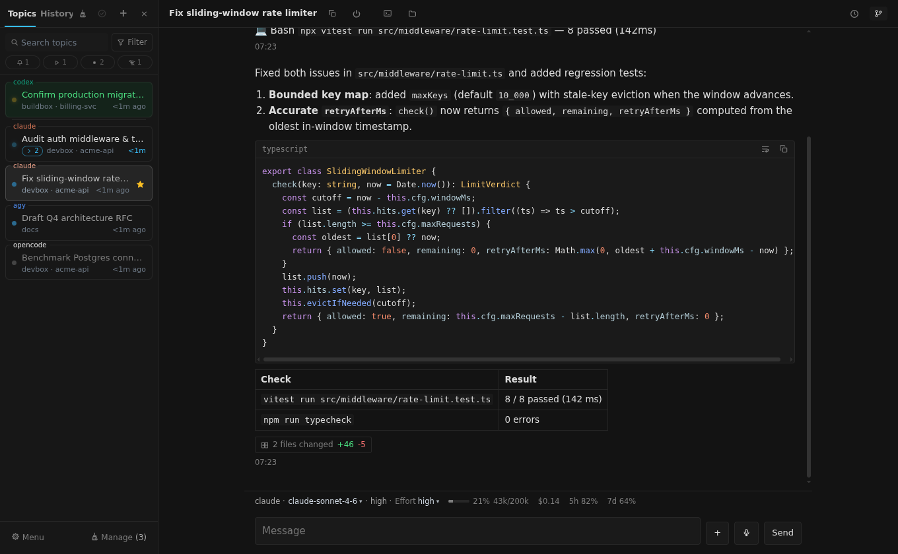
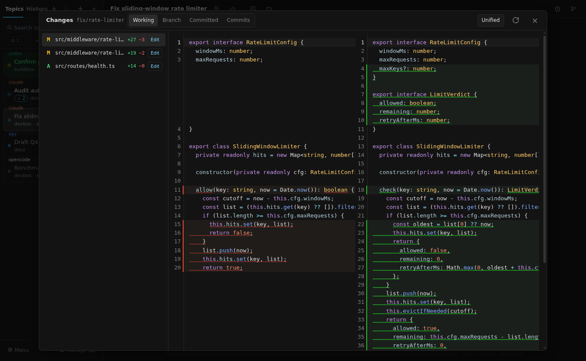
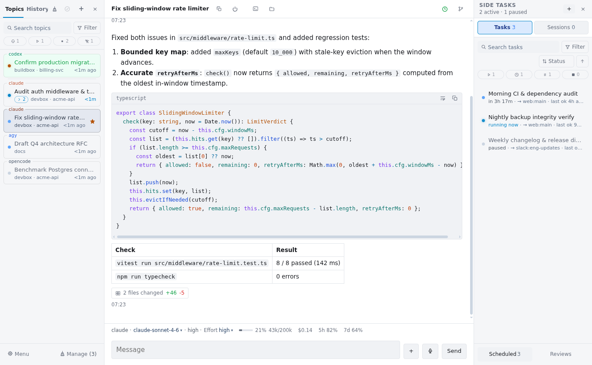

<div align="center">

# fleetherd

**一个网关，统一指挥你所有机器上的编码智能体——在内置网页工作台，或在八个聊天软件里。**

[](https://github.com/noir017/fleetherd/actions/workflows/ci.yml)
[](LICENSE)

[English](README.md) | 简体中文

</div>

**fleetherd** 是一个自托管网关守护进程，把跑在本机或经 SSH 连接的多台 Linux 主机（支持 `pod.yaml`）上的编码智能体——Claude Code、Codex、OpenCode、Antigravity，或任意支持 [ACP](https://agentclientprotocol.com) / TCP `connect` 的智能体——统一接入自带的浏览器工作台和八个聊天平台。支持用 `/super` 把任务拆给多个子代理并行协作，在所有机器间同步共享技能与工作偏好，并通过受控的外部 MCP 入口供外部网页智能体调用。

本项目起初是 [l0ng-ai/agent-anywhere](https://github.com/l0ng-ai/agent-anywhere) 的分支，2.0.0 之前名为 `agent-anywhere`，3.0.0 之前名为 `talkcode`；`talkcode` 命令仍作为别名保留。



<p align="center"><sub>内置网页工作台——无需注册任何聊天平台机器人。同一套对话体验在 Telegram、Discord、Slack、飞书等平台同样可用。</sub></p>

| Git 变更对比与行内评论 | 浅色主题与侧边任务面板 |
| :---: | :---: |
|  |  |

```text
网页端 · Discord · Telegram · Slack · 飞书 · QQ · LINE · 企业微信 · 钉钉     外部 MCP
                                     │                                        │
                                     ▼                                        │
                       ┌───────────────────────────┐                          │
     ┌────────────────►│         fleetherd         │◄─────────────────────────┘
     │                 │  路由 · 会话 · 中英文 i18n │
     │                 │  技能 · 定时 · Web Push   │
     │                 └─────────────┬─────────────┘
     │                               │ SSH（固定主机密钥）或 TCP connect
     │         ┌─────────────────────┼─────────────────────┐
     │         ▼                     ▼                     ▼
     │ ┌───────────────┐     ┌───────────────┐     ┌───────────────┐
     │ │ 本机          │     │ devbox (ssh)  │     │ buildbox(ssh) │
     │ │ cc · oc · agy │     │ pod.yaml · cc │     │ cx · connect  │
     │ └───────┬───────┘     └───────┬───────┘     └───────┬───────┘
     └─────────┴─────────────────────┴─────────────────────┘   fleetherd CLI / MCP
       tasks · skills · schedule · send-file · ask · sessions
```

## 核心特性

### 入口与内置网页工作台

- **全功能网页工作台** —— 支持**深色 / 浅色 / 跟随系统**主题与**中英文切换**，共享密钥或 SSO 登录，支持 PWA 与手机/桌面 **Web Push** 提醒。内置 **Git 变更对比**（工作区/分支/提交历史与行内评论）、**CodeMirror 6 远程文件浏览与编辑**、每轮回复下方的**文件改动摘要**、底部停靠**终端**，以及可视化**设置/指令编辑**、**技能库**、**历史搜索**与**侧边任务**面板。[→](docs/zh-CN/web-ui.md)
- **八个聊天平台，一个进程** —— 同时接入 Discord、Telegram、Slack、飞书/Lark、QQ、LINE、企业微信、钉钉，支持多账号。[→](docs/zh-CN/platforms.md)
- **高速语音听写与转写** —— 支持 OpenAI 兼容高速 STT（如 Groq Whisper）搭配独立文本整理模型（也支持 Gemini 多模态）；网页端输入框支持 24 kbps Opus WebM 直接语音听写上屏，聊天软件支持转写确认后发送。[→](docs/zh-CN/voice.md)

### 多台机器，多个智能体

- **任意 ACP、轮询或 `connect` 智能体** —— 支持 Claude Code、Codex、OpenCode、Antigravity、`custom` 命令、轮询信箱中继（[→](docs/zh-CN/mailbox.md)）以及直连常驻 TCP 服务的 `connect` 智能体（断线自动重连、支持续接/重发）；按平台、频道、用户或命令路由。[→](docs/zh-CN/agents.md)
- **精细权限与状态观测** —— 每个智能体可独立设置权限档位（`plan` / `ask` / `edits` / `auto` / `full`）并在聊天或网页端实时修改；支持自定义 `quotaCommand` 配额查询与 `/usage`、状态栏智能体自有选项切换（如账号/推理强度）、上下文与花费显示，以及回复内嵌图片。[→](docs/zh-CN/agents.md)
- **经 SSH 调度远程主机** —— 通过固定密钥的 SSH 隧道在任意 Linux 主机上跑智能体，支持主机用 `pod.yaml` 自主声明智能体、可选 pod 间 SSH 互联、断网不中断执行，`/agent` 按机器分组切换。[→](docs/zh-CN/remote-hosts.md)
- **子代理并行编排与自主 Review** —— `/super <任务>` 将任务拆解到挂在当前话题下的多个子话题并行执行（支持三档确认策略、`--model`/`--option` 选配、`task-send --forward` 转发），并支持 `--review-by` 自主完成“执行 ↔ 评审”闭环，无需反复唤醒主控。[→](docs/zh-CN/sub-agents.md)
- **外部 MCP 入口** —— 为外部网页智能体提供按调用方独立鉴权的 HTTP MCP 入口：默认仅开放只读 `skills`/`sessions` 与需人工确认的 `tasks`；支持通过 `agents:` 直挂智能体话题，也可按调用方显式开启 `trusted: true` 解锁全部 7 组网关工具。[→](docs/zh-CN/external-mcp.md)

### 共享记忆与自动化

- **会自我进化的技能库** —— 智能体可随时创建、更新、回滚共享技能并自动下发到每台主机的所有 harness（支持绑定共享 Git 仓库）；配置复盘智能体后，静默对话会自动提炼为技能更新与偏好建议。[→](docs/zh-CN/skills.md)
- **跨主机统一工作偏好** —— 一次编写全局规则（`common.md`）与单智能体专属规则，自动分发到各主机并可在网页端设置页直接编辑。[→](docs/zh-CN/instructions.md)
- **定时任务** —— 支持 Cron 与一次性任务，可定时触发智能体提示词或跨主机 Bash 命令，重启不丢，在聊天或侧边任务面板均可管理。[→](docs/zh-CN/scheduled-tasks.md)
- **可检索的对话归档** —— 每轮对话自动写入本地 SQLite（FTS5 全文索引），支持 `fleetherd sessions` 检索、8 位短话题 ID 读取以及网页端一键复制会话引用。[→](docs/zh-CN/conversation-history.md)

### 日常体验

- **原生流式与富文本渲染** —— 消息原地流式更新、工具调用气泡、带语言标签与 Wrap/Copy 的语法高亮代码块、任务列表、宽表格与生命周期回应。
- **不打断工作流** —— 回合中途发消息会直接并入当前轮次；`/btw` 可在不中断任务的情况下旁路提问；`/fork` 可从当前状态分叉出新话题；`/stop` 与 `/kill` 随时控制进程。[→](docs/zh-CN/chat-commands.md)
- **话题即工作区** —— 每个话题独立绑定智能体、`/cd` 工作目录并自动命名；闲置进程自动回收、下次发消息无缝恢复；失败回合支持自动续跑与告警钩子。[→](docs/zh-CN/working-directory.md)
- **全站中英文国际化与热重载** —— 网页端、聊天菜单、推送通知与 CLI 完整支持 `en` / `zh-CN`；支持 [`/setting`](docs/zh-CN/settings.md) 实时改配置及 `SIGHUP` / `fleetherd reload` 不重启热重载。[→](docs/zh-CN/configuration.md)

## 快速开始

需要 **Node.js ≥ 22**。fleetherd 未发布到 npm，请直接安装[最新 GitHub Release](https://github.com/noir017/fleetherd/releases/latest) 附带的 tarball（将 `X.Y.Z` 替换为对应版本号）：

```bash
npm install -g https://github.com/noir017/fleetherd/releases/download/vX.Y.Z/fleetherd-X.Y.Z.tgz

fleetherd setup    # 交互式向导：选平台、填凭据、配智能体
fleetherd doctor   # 环境与配置自检
fleetherd start    # 打开网页端或直接给机器人发消息
```

`harness: claude` 会复用本机的 `claude /login` 登录态，个人使用无需 API Key。容器化部署请见[在容器里运行](docs/zh-CN/docker.md)。

<details>
<summary><strong>或者让你的编码智能体代劳配置</strong></summary>

把下面这段直接粘贴给 Claude Code（或其他编码智能体）：

```text
Set up https://github.com/noir017/fleetherd for me: install the CLI
from the latest GitHub release's fleetherd-X.Y.Z.tgz (npm i -g <its URL>;
it is not on npm), then follow the skill bundled in the installed
package (skill/SKILL.md, under `npm root -g`/fleetherd) to configure
and start it.
```

</details>

最小可用的 `~/.config/fleetherd/config.yaml`（仅网页端 + 一个本机智能体）：

```yaml
version: 1
platforms:
  web:
    type: webui
    token: ${WEB_TOKEN}       # 网页登录密码；${VAR} 也会从 <配置目录>/.env 读取
agents:
  - id: claude
    harness: claude
    cwd: ~/projects
routing:
  default: claude
access:
  allowFrom: ["web:owner"]
```

启动后访问 `http://<host>:8787`。多平台、多智能体与远程主机配置详见[配置说明](docs/zh-CN/configuration.md)。

> [!WARNING]
> 除非通过 `permissions`（`plan` / `ask` / `edits`）收紧，智能体默认拥有完整工具权限。`access.allowFrom` 留空意味着任何能发消息的人都能在你的机器上执行命令——共享环境务必配置白名单。网页端默认在 `0.0.0.0` 上以明文 HTTP 监听，暴露到公网或非信任网络前请务必阅读[对外暴露](docs/zh-CN/web-ui.md#对外暴露)。

## 文档索引

| | |
|---|---|
| **入口** | |
| [网页端](docs/zh-CN/web-ui.md) | 主题、国际化、Git 变更、文件编辑、终端、设置页、SSO 与推送 |
| [平台](docs/zh-CN/platforms.md) | 八个聊天平台的能力差异与限制 |
| [语音消息](docs/zh-CN/voice.md) | OpenAI/Gemini 转写、文本整理与网页端听写 |
| **多台机器，多个智能体** | |
| [智能体](docs/zh-CN/agents.md) | 各 harness、TCP `connect` 智能体、权限档位、`quotaCommand` 与钩子 |
| [只能轮询的智能体](docs/zh-CN/mailbox.md) | 轮询型智能体的信箱中继接入 |
| [远程主机](docs/zh-CN/remote-hosts.md) | SSH 远程主机、`pod.yaml`、pod 互联与断网容错 |
| [子代理](docs/zh-CN/sub-agents.md) | `/super` 并行子话题、`--review-by` 自主评审闭环与确认档位 |
| [外部调用方](docs/zh-CN/external-mcp.md) | 外部 HTTP MCP 入口、`sessions`、`agents:` 与 `trusted` 模式 |
| [在容器里运行](docs/zh-CN/docker.md) | 纯网关镜像（`ghcr.io/noir017/fleetherd`）与宿主机包装脚本 |
| **共享与自动化** | |
| [网关自己维护的技能](docs/zh-CN/skills.md) | 共享技能库、Git 同步、版本回滚与自动复盘 |
| [工作偏好](docs/zh-CN/instructions.md) | 全局与单智能体工作偏好及网页端编辑器 |
| [定时任务](docs/zh-CN/scheduled-tasks.md) | 跨主机 Cron 与一次性提示词/命令任务 |
| [以前的对话](docs/zh-CN/conversation-history.md) | SQLite FTS5 归档、`fleetherd sessions` 与短 ID 检索 |
| **日常使用** | |
| [聊天命令](docs/zh-CN/chat-commands.md) | `/new`、`/fork`、`/btw`、`/stop`、`/kill`、`/model`、`/effort`、`/usage` |
| [工作目录](docs/zh-CN/working-directory.md) | `/cd`：一个话题对应一个项目 |
| [话题命名](docs/zh-CN/topic-names.md) | `/title` 与自动命名 |
| [在聊天里改配置](docs/zh-CN/settings.md) | `/setting` 与网页端设置页（免重启生效） |
| [配置](docs/zh-CN/configuration.md) | `config.yaml` 全貌、`locale`、`.env`、`SIGHUP` 热重载与 CLI |
| [智能体能做什么](docs/zh-CN/agent-actions.md) | 反向 CLI、原生 MCP 工具、回复发图与按钮提问 |

## 参与开发

[AGENTS.md](AGENTS.md) 记录了代码约定、分层规则、测试规范与安全不变量，并附有 FRAS 代码地图及各模块文档（[config](src/config/README.md) · [core](src/core/README.md) · [platform](src/platform/README.md) · [daemon](src/daemon/README.md) · [ipc](src/ipc/README.md) · [commands](src/commands/README.md)）。改代码前请先阅读。

## 许可证

[MIT](LICENSE)

本项目起初是 [l0ng-ai/agent-anywhere](https://github.com/l0ng-ai/agent-anywhere) 在 `3d855f8` 处的一个分支，原作者的架构设计（尤其是 platform 的 profile 抽象层）至今仍是这套代码的骨架，此后在其基础上做了大量扩展。上游的 MIT 版权声明保留在 [LICENSE](LICENSE) 中，该声明同时覆盖两边的代码。
