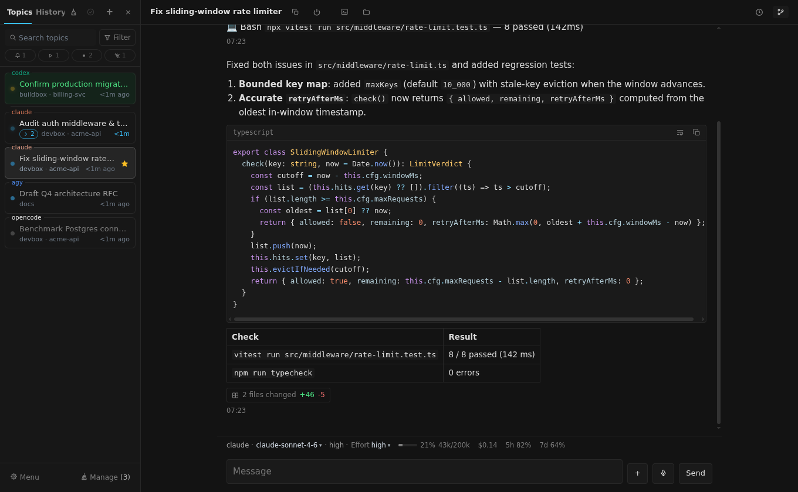

# Web UI

English | [简体中文](zh-CN/web-ui.md)



A VS Code-style workbench the daemon serves itself, styled in VS Code Dark Modern / Light Modern.
No bot to register, no account, no upstream service — it is the fastest way to have a working
gateway, and the only one that works with no chat platform at all.

```yaml
platforms:
  web:
    type: webui
    token: ${WEB_TOKEN}       # required: the shared secret the login page asks for
    host: 0.0.0.0             # default; 127.0.0.1 to keep it to an SSH tunnel
    port: 8787                # default
    title: Chat               # default; the browser tab's title

access:
  allowFrom: ["web:owner"]    # the identity is always <instance id>:owner
```

Open `http://<host>:8787`, enter the token, and you have the same conversation
every other platform gets: streaming replies, tool bubbles, the `/model`, `/effort`
and `/cd` button menus, `ask` questions, file upload and download. Menus are
laid out as a grid with the current choice lit, and hold 24 to a page where chat apps hold 12.

**Workbench layout.** The page is assembled as a plugin-driven workbench (12 built-in plugins:
Topics, Topic editor, History, Scheduled, Reviews, Skills, Settings, Changes, Files, Terminal,
Reader, and Status):

- **Activity bar** (left rail): switches the primary sidebar between **Topics**, **History**,
  **Scheduled**, **Reviews**, **Skills**, and **Settings** (pinned at the bottom).
- **Primary sidebar, editor area, secondary sidebar, and bottom panel**: lists live in the primary
  sidebar, conversations and editors (settings, skills, history, files, diffs, document reader)
  open in the center editor area, topic-scoped **Changes** and **Files** open in the secondary
  sidebar on the right, and per-topic **Terminal** docks in the resizable bottom panel.
- **Status bar** (bottom strip): shows connection state, running/idle agent counts (**Close idle**),
  plugin errors, **Notifications**, **Low attention**, **Language** (`English` / `简体中文`),
  **Theme** (`System` / `Dark` / `Light`, VS Code Dark Modern `#1f1f1f` / Light Modern `#ffffff`),
  and daemon version.
- **Responsive breakpoints**: desktop (`≥ 1024px`) shows the full multi-pane workbench and
  auto-collapses the primary sidebar when the editor becomes narrow; tablet (`640–1023px`) turns
  sidebars into slide-over drawers; mobile (`< 640px`) keeps the topic view as the main screen and
  slides the sidebar drawer in over it via the header menu button or a swipe from the left edge,
  with a bottom tab bar (**Topics**, **History**, **Scheduled**, and **More** for **Reviews**,
  **Skills**, **Settings**, device preferences, and gateway status). Picking a topic, tapping
  outside, swiping it back, or using the phone back gesture closes the drawer; topic tools (Changes,
  Files, Terminal) stay reachable from the topic header.
- **Drag-and-drop splits, view movement, and layout persistence**: on desktop (`≥ 1024px`), drag
  any editor tab onto the left, right, top, or bottom edge of an editor group to split side by
  side, or drag tabs within the permanent editor tab strip to reorder them (press `Esc` to cancel a
  drag). Views in the primary sidebar, secondary sidebar, and bottom panel can be dragged between
  parts or moved via the **⋯** (**Move view**) button in each part header. Layout state is saved
  automatically in this browser (`localStorage['aa_layout']`) and restored on reload (corrupt state
  falls back to the default layout). On tablet widths (`640–1023px`), editor splitting is disabled
  while tab reordering stays enabled.
- **Layout keyboard shortcuts**: `Ctrl/Cmd+\` splits the active editor right; `Ctrl/Cmd+1`,
  `Ctrl/Cmd+2`, and `Ctrl/Cmd+3` focus editor groups 1–3; `Ctrl/Cmd+B` toggles the primary sidebar;
  `Ctrl/Cmd+Alt+B` toggles the secondary sidebar; `Ctrl/Cmd+J` toggles the bottom panel. The
  **Reset Layout** command (`workbench.action.resetLayout`) clears saved layout state and restores
  the default arrangement.

`/setting` is a page of its own rather than a message in the transcript: the **Settings** icon at
the bottom of the activity bar opens it, and typing `/setting` does the same.
It is one column of sections, and each setting is changed in place with the control that fits it: a
switch for on/off, a segmented control or a dropdown for a short list, and a card per agent, grouped
by machine, showing its harness in a colour of its own, its model and its permission level. A tap
opens one card: the model shows its whole id and opens that agent's list, any agent's, running or
not, with a field that filters it and takes a name it does not have; the levels sit side by side with
what the chosen one does under them, written as soon as you pick; and, with the instruction editor
on, every file the agent reads is listed — the shared ones and its own. A value in italics is not
set and is what applies. A banner says what
each change did, or why it was refused. The bar says these are saved to config.yaml for every topic
— none of them is the topic's own — and the agent answering the topic you opened it from is marked
*this topic*; switching topics puts the page away. What you type stays in the transcript as your
message — the page does not. See [settings](settings.md).

**Switching the model.** The line above the composer names the agent and its model, and the model
is a button: it opens the models the topic's agent offers, the one in use ticked and the agent's
default marked, with a filter when the list is long. A tap switches this topic only — the same as
typing `/model <id>`, so a typed `/model` afterwards says the same — and config.yaml is not
touched; each agent's default is in **All settings**. An agent with no session yet is started to
ask (a second or two, said while it happens); a harness that offers no model choice says so. The
switch is there as soon as a topic has an agent — right after you pick one from the new topic's
list, so the first message can already go to the model you want; until that first reply the line
reads just *Model*. The choice stays with the topic across `/new`, `/cd` and restarts.

**The agent's own settings.** An agent can offer settings of its own beside the model — a web
agent's account, say — and each gets a button of the same kind next to the model, named for the
setting and showing its current value. It opens that setting's choices, each with the agent's note
on it as a second line (an account whose quota is used up says so), and a tap sets it for this
topic. What can be changed, and when, is the agent's call: a setting it offers only one value for
is drawn dim and cannot be tapped (hover it for why), and a change it refuses stays open in the
list with its reason. In a new topic the button appears once you pick the agent, before the first
message — for a setting like an account, that is the moment it can still be changed. The gateway
keeps nothing of these: the agent remembers its own setting, and `/new` or `/cd` start a session
on the agent's default again, so pick the directory first. Only the web UI shows them; there is no
command for them.

**Switching permissions from the status line.** Beside the model and agent options, the status line
above the composer also shows the topic agent's current permission level as a clickable chip. Tapping
it opens the same popover with the available permission levels (`ask`, `auto`, `full`) and updates
that agent's permission level without leaving the conversation.

**Topics.** The sidebar on the left lists parallel conversations and switches between them,
the same way a Telegram forum topic or a Feishu 话题 does: each has its own agent
session and its own context, and each gets named automatically from what it turned
out to be about. The agent that answers a topic sits on the top-left edge of its row, in the colour
of its harness — just the id, since the machine is named on the line below — and hovering it shows
the whole id; the title line is the subject alone. `+` opens
one; the agent can open one itself with
`fleetherd create-thread`, and write into one with `--channel main/<topic id>`. Under each
title is the directory the topic works in, led by the machine when its agent runs on a
[remote host](remote-hosts.md) (`devbox · fleetherd`); hover it for the full path. At the right
end of that line is the time: how long the topic has been working (`3m`, `1h`, `1d10h`, in blue
while it runs), or how long ago its last turn ended (`12m ago`, grey). Hover it for the clock
time. A topic nothing has been said in yet shows none. A machine the
gateway cannot reach is marked there, over its agents on a new topic, and above the composer
([When a host is offline](remote-hosts.md#when-a-host-is-offline)). At the end of
each row a **⋯** button (on hover or keyboard focus; always shown on a touch screen) opens that
topic's menu without switching to it: **Star**/**Unstar**, **Copy reference** (copies `<title> (<instance>:main/<id>)` so you can paste it into another conversation for an agent to inspect via `fleetherd sessions read`), **Fork** (copy the conversation into a
new topic beside it — see [`/fork`](chat-commands.md#forking-a-topic-fork)), **End agent**, and
**Delete topic** (red, with the same confirmation as before). **End agent** ends the process behind this topic and
every sub-agent topic under it as soon as it is clicked — the item reads **End agent + N
sub-agents** when there are any, so how far it reaches is on screen before you press it, and a
running turn is interrupted on purpose. Every conversation is kept, and the next message resumes it. A starred row shows a
lit star at its end even when you are not hovering: a marker, not a button. Drag its right
edge to make it wider or narrower — the width is kept in this browser — and double-click the edge
for the default. On a narrow screen it becomes a drawer. Above the list, a search field and
**Filter** narrow it: the search matches the title, the agent, the directory name, its full
path and the machine, word by word, and a row of four state chips under the search — **Needs
you**, **Running**, **Idle**, **No agent** — is always on screen. **Filter** holds the rest: star,
agent and host. Several values in one group widen the result, values in different groups narrow
it. When the column is too narrow for the state words, the chips keep their icon and count and
the full name moves to the hover text. Filtering keeps or drops a whole conversation — the root
and every sub-agent under it — so a match anywhere in it keeps all of it, drawn exactly as it is
without a filter: the same fold and fold count, the same needs-you block and order, nothing
dimmed. The chips and **Showing N of M** count conversations, one tree each. **Clear** puts the
whole list back. The keyword and the filters are kept in this browser. The × in its header closes it at any
width, and the same × closes the task panel on the right: the two are one component, with the
same header and footer rows, the same slide and the same dimmed backdrop.

**Choosing an agent.** With more than one agent configured, a new topic opens on all of them,
grouped by machine: each card shows the agent's id, what it is (Claude Code, Codex, OpenCode,
Antigravity, or a custom agent's command) and its model if one is set. On the same page sits an
inline folder browser for the selected agent (with `/cd`'s breadcrumbs, parent navigation, and
filtering, showing only the current level's subfolders), plus a summary of the current agent and
folder choice. You can pick the agent and folder in any order without leaving the page or echoing
commands into the transcript (leaving any draft in the composer intact). Picking an agent folds the
agent cards away and picking a folder folds the folder browser away, leaving the summary bar with a
**Change** button to expand both again; switching the agent moves the folder browser to that agent's
root, and the status strip immediately offers that agent's model
and settings (such as account) switches. Or just type — the card marked **default** is the agent
that answers. The launcher goes away as soon as anything is said in the topic.

**Stopping it.** While a reply is streaming, **Stop** beside Send ends the turn
(`/stop`) — and the same goes for an agent reporting back on background work after
its turn ended, which the topic shows as running too. While an agent process is up
behind the topic, the power button beside its title ends the process (`/kill`) — the
conversation is kept, and the next message picks up where it left off. Both simply
send the command, so a draft in the composer is left where it is.

**Narrow composer.** When the composer itself is too narrow to hold the input and the buttons side by side, it splits into two rows: the text area takes the full width across the top row, and the action buttons sit on the second row with file attachment and voice recording on the left, and Stop and Send on the right. The width that counts is the composer's own, not the window's: at 480px of composer or less it splits, which with the sidebar at its default width means a window between 641 and 752px — the case where the topic list still takes a column and the input was left with as little as 213px — and also a wider window whose sidebar has been dragged wide. On a handset (640px and below) it is always the layout.

**Closing idle agents.** An agent process stays up after its turn until the daemon's idle
timeout reclaims it (the dim blue dot). Clicking the **Idle** counter in the status bar ends all
of them at once: it lists the topics it is about to close, asks, and then says which were closed.
Each conversation is kept, and the next message in a topic starts its agent again where
it left off. A topic that starts working in the meantime is left running, and starred topics are
closed like the rest. **Clear all topics** is an icon button beside Topics in the sidebar header.
Beside it, **Mark all read** clears every unread badge in the topic list and tells the daemon the
finished replies it had not seen have been read, as the Sessions tab's button does for scheduled
runs; it is greyed out while there is nothing to mark.

**Side tasks.** The clock at the right of the chat header opens a panel with two tabs at its
foot: **Scheduled** and **Reviews**. Inside **Scheduled**, two sub-tabs under the header separate
**Tasks** (default) and **Sessions**. **Tasks** lists every task the gateway has registered — what
it runs, when it runs next, where its output goes, and how the last run ended. Above that list a
search field, **Filter** and a sort narrow and order it: the search matches the task's name, its
prompt or command, and its target; a row of four **Status** chips under the search — Running,
Active, Paused, and Ended (expired and done together) — is always on screen, and **Filter** holds
**Tags** (every tag in use, plus **Untagged**); the sort switches
between **Status** (the default), **Next run**, **Last run** and **Created**, either direction, and
a task with nothing to sort by stays last. The keyword, the filters and the sort are kept in this
browser, and **Showing N of M** with **Clear** says what survived. **Sessions** lists the
topics a new-session run opened; those topics are kept out of the main topic list, so this is where
they live, and tapping one opens it (its ⋯ holds **Star**, **Copy reference**, **Fork**, **End agent** and **Delete topic**, the
same menu a topic row has). A sub-agent a run opened is listed under that run, folded behind the
same count pill a topic's sub-agents are, rather than in the topic list. The list groups this month's runs by day and
older ones by month, each header folding on its own and the choice kept in this browser — the newest
group and the one holding the topic on screen start open, and a folded header still says how many
replies are unread and whether a run is working or waiting on an answer. **Mark all read**, the
check icon in the panel's title while Sessions is open, clears every run's unread badge at once and
tells the daemon the replies it had not seen have been read.
**Reviews** lists the automatic reviews of
quiet conversations (see [skills](skills.md#auto-review)): what each one changed, what the store
refused and why, the preferences it noticed, and the command that undoes each change. Opening a
review shows its reviewer, model, message count, duration, and inline diffs for applied skill edits,
with a **Revert** button (behind confirmation) to roll back an applied skill commit directly from
the detail view. A review that changed nothing posts no line anywhere else, so this tab is its only
home. Above the reviews,
**Suggested preferences** lists the preference suggestions still pending, merged across reviews,
each with **Adopt** and **Dismiss**. Adopt opens a new topic with a draft that asks an agent to add
the suggestion to your instructions; nothing is sent, so you can edit it, switch agent with
`/agent` first, or throw it away. The suggestion leaves the list only once a message that still
carries it goes out from that topic. Dismiss takes it off the list without doing anything else.
A run — or a sub-agent under one — waiting on an answer puts an amber dot on the clock itself, on
the Scheduled tab, and on the Sessions sub-tab, since it has no row in the topic list to show it.
The panel is a column of its own on a wide screen. It is the same component as the topic sidebar
on the other edge — same header and footer rows, same ×, same slide and backdrop — and only its
default width and the width at which it stops being a column differ. Below 1024px it is a drawer
that slides in from the right, at most 88% of the screen wide, with a strip of the chat still
visible; below 640px the topic sidebar is that same drawer on the left. The dimmed chat behind it
is what closes it. It is closed by default, and only a docked panel is restored on a reload; on a
narrow screen it opens from the clock each time. Opening a session leaves a docked panel where it
is. It is narrower than the topic sidebar — drag its left edge to resize it, double-click the edge
for the default width. A task is a row like a topic's: a state dot, the name, and one line under it
with what it is doing (a countdown, `running now`, or the state word), where it posts, how the last
run ended (red when it was not ok) and its tags. The cron expression, the next run in full, the
target and the run mode are on the row's hover card and on the task's page a tap opens. The page
holds the full prompt or command, the tag editor (the × on a tag removes it, the **+ tag** field,
saved with Enter, adds one), the topics its runs opened, and its recent runs, each with a link to
the topic it posted into; its **Edit** changes the task in place — see
[Scheduled tasks](scheduled-tasks.md). The row's ⋯ holds **Pause** or **Resume**, **Run now** and
**Edit** (both greyed while a run is in flight, with the reason) and **Delete**, which asks once,
like deleting a topic. The **+** in the panel's head adds a task on the same form **Edit** uses —
or ask an agent in a topic, which registers one the same way.

**What needs you.** Every topic waiting on you moves to the top of the list, its title in green,
with a line under the group: a question to answer first (amber dot), then a turn that failed (red
dot), then a reply you have not read yet (green dot). Hover a row for what it is — a reply's first
line, which is usually the conclusion. Both a finished reply and a failed turn go back to their
place once you have looked at them.

A sub-agent's topic is not one of these: its finished replies and failures are the news of the
agent that opened it, so it is never moved up, and its finished turn keeps the ordinary idle/online
dot instead of the green one. Its questions (amber) and its work (blue) are unchanged, and the
topic that started it is what turns green when the answer is waiting for you.

Below that group, a topic with no title yet comes first — a new conversation is where you are
about to work — and the rest is ordered by what each topic is doing: working, then an agent that
is up with nothing to do, then one with no process behind it. The directory menu a new topic shows
after you pick its agent is not one of these: it is a control for your own next step rather than
something an agent is blocked on, so a topic you leave half set up keeps its place and sends no
notification.
[Sub-agent](sub-agents.md) topics are folded under the topic that opened
them — tap the count to open them — and a topic whose sub-agents are still working is shown as
working itself, even between its own turns. They move up only for a question of their own — the
agent that opened them reads the rest. A link to a topic in a
reply opens it in place.

**Low attention.** With several agents working at once the list keeps moving: every running
topic's dot pulses, and its unread count climbs in a bright blue pill with each message. Turn on
**Low attention** in the status bar and that stops: a running
topic's dot stays bright blue but holds still, and unread counts turn grey. A question waiting on
you (its amber dot still pulses), a failed turn and a reply you have not read still move to the
top in green, so they are the only things that stand out. The setting is kept in this browser
only. **Theme** (`System` / `Dark` / `Light`, applied before first paint and shared with the code
viewer and syntax highlighting) and **Language** (`English` / `简体中文`, switched in place without
reloading) are also toggled directly in the status bar alongside **Notifications** and **Close
idle**; **Settings** and **Skills** live in the activity bar, and **Clear all topics** is an icon
button beside Topics in the sidebar header.

**Code in a reply.** Every code block has a bar naming its language, with **Wrap** (long lines
break inside the block instead of scrolling sideways) and **Copy** (the code exactly as written,
with a check mark for a moment). Once a message has stopped changing its code is coloured with the
same grammars as the file viewer; the message a running turn is still writing stays plain until a
newer message follows it or the turn ends. A `diff` or `patch` block shows added lines green,
removed lines red and hunk headers blue as it streams in. A block indented under a list item is a
block there, not a line of code text. A table scrolls sideways inside its own frame on a narrow
screen, a `|` inside a cell's `` `code` `` (or written `\|`) no longer splits the cell, and
`- [ ]` / `- [x]` items show as boxes, unticked and ticked — read-only, since ticking one would
tell the agent nothing.

**Tool calls, in full.** Each tool the agent runs is one row in its tool bubble, and here
a row carries the whole command — up to 2000 characters — where a chat app gets the
first 40 (`tools.previewLimit`). The row is cut at the edge of the bubble, so a wide
screen shows as much as fits, and the ✓ and duration at its end always stay visible.
Click a row to read it in full, and again to fold it; **Show all** under the bubble
opens every row, including the ones the agent adds after you press it.

**Sub-agent traffic.** A bubble that is about a sub-agent rather than a reply is marked at its
top with **Sub-agent task** or **Sub-agent report**, and gets a rail in a colour of its own. A
task is the hand-off: the card that asks you to start the sub-agents, the record of what started,
and the task text a sub-agent's topic is handed (the message opening `↳ From …`, and every
`task-send` after it). A report is the folded `🔔` card the agent that opened the sub-agents is
told with — one row per sub-agent, folded and opened exactly like a tool bubble — or the reply a
`task-send --forward` carries into a topic, folded the same way. The mark travels
with the message, so a reload and a daemon restart keep it; a chat platform shows the same text
unmarked.

**Side questions.** A [`/btw`](chat-commands.md#side-questions-btw) and its answer stay out of the
transcript, so an answer that lands in the middle of a reply still streaming does not read as that
reply's next paragraph. Where you asked, the transcript keeps one line — **BTW**, the question, and
*Waiting…* or *Answer* — and the answer is read in a card over the composer that opens as soon as
you send the question and follows the answer as it is written. × or Escape puts the card away (it
stays shut while the rest of that answer arrives); the line opens it again. An answer from before
this version, or one whose question is no longer in the topic, is still drawn in the transcript,
marked **Side question** with a dashed rail.

**Pictures.** Paste a screenshot (Ctrl-V) or attach one and it shows as a thumbnail in the
composer, with an × to take it back off the message. Once sent, your message shows it too, and a
tap fills the screen with it. The daemon keeps that copy only while it is running: after a
restart, a message from before it keeps the picture's name but not the picture.

A picture over 300 KB is shrunk in the browser before it is sent: it is fitted to about 3.1
megapixels — 2048×1536 at 4:3, which is what a model can use of a photo, with a 4096 px cap on
one side for a panorama — and the quality is taken as high as still fits under 300 KB, so a phone
photo uploads in a moment and the agent still sees it in full. A common phone screenshot keeps
its own size or comes out close to it, so its text stays the size it was. JPEG, PNG and HEIC all
go out as WebP where the browser can write it, as JPEG where it cannot; a GIF keeps its animation
and is sent as it is, and a picture the browser cannot decode is sent untouched. Re-encoding
drops the camera's EXIF data, location included.

**Reading a file without downloading it.** When the agent sends a Markdown file, a log, a
CSV or a source file, click its name and it opens in a window over the conversation; **Download**
beside the name saves it as before. Markdown is rendered like a reply, with headings, tables and
code blocks; anything else opens in a code view with syntax highlighting and line numbers, wrapping
on a phone — a browser that could not load the editor shows the same text plain. An `.html` or
`.svg` file is shown as its source and is never run. A file over 512 KB shows its first 512 KB and says so, and the **Download** link
in the window's bar fetches the whole file. PDFs, office documents and other binary files have no
preview and stay downloads. Like the download link, preview works only until the daemon restarts;
a message from before a restart keeps the plain download link.

**Built for a bad connection.** Replies are sent when they settle rather than on
every keystroke of the stream, everything on the wire is compressed, and a dropped
connection resumes from where it left off instead of re-downloading the
conversation. In a 30-second streamed answer that is 13 updates collapsed to 3, at
about a quarter of the bytes. The page itself is downloaded once per version: a reload
only asks the daemon whether it changed, and the first reload after an upgrade gets the
new one. A tab you are not looking at stops receiving after 15 seconds and catches up
the moment you come back to it, and going back to a topic you just left fetches only
what was said since. Every topic that needs you — green in the sidebar, and a scheduled run
or a sub-agent that has finished or is asking — is fetched in the background before you open
it, in the order the sidebar lists them, and kept in the browser, so tapping it shows its
latest state at once — after a reload too, and for a topic you left while it was still
working. Anything that changes in it afterwards, an edit included, has it fetched again. Attached files go up as they are, not in a text encoding a third
larger. Sends carry a nonce, so the page retries safely on a
link that drops them. A send that gets no answer at all does not stay grey: after 15
seconds (longer for a big attachment, up to 5 minutes) it turns red with **Retry**,
**Copy** and **Discard**. A message that is still grey after that has not left the
browser.

**Nothing you typed is lost to a dropped connection.** A message is written down in the
browser the moment you send it and kept until the daemon has it, so a reload — including
the one an expired Cloudflare Access session forces on you — brings it back under the
conversation instead of losing it. If the page went away before the daemon answered, the
message says it is not confirmed until the page has checked; if the daemon never got it,
it turns red with **Retry**. Retry after a reload works for text; a message that carried
files offers **Copy** and **Discard**, because the files themselves are not kept. The
composer's draft is saved too, a second after you stop typing.

## Skills

**Skills** in the **⚙ Menu** at the bottom of the topic list opens the gateway's managed skills — the ones every
agent is given (see [Skills the gateway keeps](skills.md)). The page lists each skill with its
status (active, expired or archived), whether it is pinned and when it was last used. **New**
creates one; opening a skill shows its files, a `SKILL.md` editor and every recorded change, and
**Delete** archives it rather than removing it — **Restore** brings it back. Saving `SKILL.md`
carries the version the page read, so an edit made elsewhere is refused instead of overwritten.
The page writes through the same store as `fleetherd skills`, and an archive made here still tells
the conversation that created the skill.

The name is what an agent is told in a chat, so every row and the skill's own page carry a copy
button for it. The window keeps the list it last drew in this browser: the next open shows it at once and asks the
daemon again behind it, and the list is redrawn only if the answer changed. A failure behind it
says nothing; the refresh button in the window's header asks by hand and reports one. On a skill's
page that button also re-reads the skill — unless the editor holds unsaved text, which it never
overwrites.

## Changes

The branch icon in the chat header opens the repository the topic's working directory sits in. It
is read-only: it lists what changed, shows a diff, and takes comments into the composer — nothing
here stages, commits or discards, because an agent is usually working in that repository at the
same time.

The bar has three comparisons and the history. **Working** is the working tree against `HEAD`,
untracked files included; **Branch** is the working tree against the merge base of `HEAD` and a base
branch, so committed and uncommitted work read together; **Committed** is `HEAD` against that merge
base. The base starts at the repository's default branch (`origin/HEAD`, else `main` or `master`)
and can be changed in the picker. A repository with no commits works too. Every path is relative to
the repository root, also when the topic's directory is a subdirectory of it. A directory the agent
just created is listed file by file; where there are too many untracked files to count them all, a
row says the counts were not read rather than showing `+0 −0`.

**Commits** lists the history itself: each commit with its short sha, subject, author and how long
ago. **Load more** pages further back. Opening one shows its message — the body folded away until
you ask for it — and the files it changed; **← Commits** goes back, and **Refresh** re-reads the
list. A file opened there is read from that commit and not from the working tree, and a line
comment made on it carries the short sha beside the file and lines, so an agent cannot take it for
a remark about today's file. The base picker belongs to the three comparisons and is not shown in
**Commits**.

An empty comparison says which one is empty and what it was compared against, and offers **See
commits** rather than leaving the right half of the window blank; a directory that is not inside a
repository says so in the middle of the window instead of reading as a failed request. On a wide
window the first file of a comparison opens by itself; a turn's own changes and a phone's list wait
to be picked, because a phone's two columns are stacked there and an opened file would push the
list out of sight.

Clicking a file shows its diff — one column or two, from the button in the bar; a phone opens on one
column. Selecting lines in the diff offers **Comment**; the file, the line range, which side of the
diff they came from, the selected lines in a code block and your comment are inserted into the
composer, where you can edit them and send when you are ready. Several comments accumulate. Nothing
is sent from the window. A browser where the code view is unavailable gets the plain patch with
added and removed lines coloured instead; there is no line selection in that mode, so **Comment** is
not offered.

The list refreshes when a turn in the topic ends, so it follows what the agent just did. Each row
has an **Edit** button when the page also has a file editor; it opens that file by its absolute
path. The editor applies its own workspace fence, so a file outside the topic's directory may still
be refused there.

## History

The topic list has two tabs at its top: **Topics** and **History**. History lists every
conversation the gateway has recorded — whichever agent and platform it ran on. It is the same
library `fleetherd sessions list/search/read` reads. A review's own session is left out; those are
read on the Reviews tab. Each row (and the header while viewing a topic or a History conversation) also offers a copy button that copies `<title> (#<id>)` — or `<title> (<instance>:main/<id>)` for an active topic — so you can hand any conversation straight to an agent.

A row says the title, the agent, the platform, when it was last active and how many messages it
holds. **Load older conversations** pages further back — as far as the gateway has been recording.
Typing in the search field and pressing Enter searches every conversation at once; clearing the
field puts the list back. The list is read again each time you open the tab.

Clicking a row opens the conversation where a topic is read, drawn the same way: your messages,
the agent's replies with their formatting, tool calls folded into lines. It is read-only — the
composer is replaced by a line saying why nothing can be sent: the conversation may have run on
another platform, or its topic may have been cleared from this page. If it is still a topic here,
**Open the topic** switches to it. A long conversation is cut at 500 messages and says so beside
the last one shown: what you are reading is part of the conversation, not all of it. The library
keeps less than a topic did — a run of tool calls is one line, and there are no buttons, pictures
or timings.

**Close**, the **Topics** tab, or opening any topic puts the topic you were in back where you left
it. On a phone, picking a conversation closes the drawer; open it again and tap **Topics** to go
back. Neither the tab nor the conversation is remembered: a reload opens on Topics, on the topic in
the address.

## A turn's changes

When a topic works in a git work tree, each turn records what it changed: a snapshot of the
work tree is taken just before the agent is asked and another when the turn ends, and the reply
ends with a line — `3 files changed +12 -4`. A turn that changed nothing gets no line.
Tapping it opens that turn's diff, file by file,
in the git window; the list is also how you get from "something changed" to the file that did.

The snapshots are the daemon's own, under `~/.fleetherd/snapshots/<hash of the repository root>`
on the machine the agent runs on, and the project's `.git` is never touched. `.gitignore` decides
what a snapshot takes, with git's own exception: a file a snapshot has already recorded stays in
it even if it is ignored afterwards. A topic keeps its last 50 turns, across restarts; older ones
are deleted and their objects pruned.

The first snapshot has three seconds. A snapshot that fails, or a turn slower than that to get
going, simply has no entry — the turn itself is never delayed past that or failed. Only turns
on the web UI are recorded: a chat reply has nowhere to put a diff, and a directory that is not
a git work tree has nothing to compare.

Two topics working in the **same directory** at the same time see each other's edits: each one's
diff is "the work tree before my prompt" against "the work tree after", so an edit the other made
in between is in both. Two chats on one project at once is the one case this does not separate.

## Notifications

**Notifications** in the **⚙ Menu** at the bottom of the topic list turns on push notifications
for this device. The browser asks for permission once. After that the device is notified even when the
page is closed or the phone is locked. Tapping a notification opens the topic. The topic is
fetched into the browser when the notification arrives, so it opens on the reply at once.

What notifies: any topic that starts needing you — for a sub-agent's topic, only a question of its
own. A topic you are reading when it happens does not notify. Turn it on in each browser where you want notifications, and off the same way.

- Chrome, Edge and Firefox on desktop and Android. On iPhone and iPad, only after **Add to Home
  Screen** (iOS 16.4 or later), opened from the home-screen icon.
- The page has to be served over HTTPS (or from `localhost`). A plain `http://` address on the
  network cannot ask for notifications.
- Notifications go through the browser maker's push service (Google, Mozilla or Apple). The
  gateway needs to reach it over HTTPS. The content is encrypted for your device, and is only the
  topic's name and one line.
- The key and the devices are kept in `~/.config/fleetherd/webui-push-<instance>/`. Deleting the
  directory forgets every device, and each one has to turn notifications on again.

## Terminal

Turned on, the chat header grows a `>_` button that
opens a real shell on the machine the daemon runs on — so you can drive *any*
coding-agent CLI, TUI and all, from the same page. It is a panel at the bottom of
the conversation, half the chat tall to begin with: the transcript and the
composer stay on screen and usable, and the divider above it drags to whatever
height you want (the arrow keys work too, a double-click goes back to half). That
height is kept in the browser and comes back after a reload. It is one panel per
topic, and its two buttons mean different things: minimize parks it while
everything keeps running and stays attached — switch to another topic and back
and it is the same terminal, not a reconnect — and close ends the session for
good. The topic list marks which topics have a terminal open. The daemon does not
implement a terminal: it proxies, behind the same login, to a
[`ttyd`](https://github.com/tsl0922/ttyd) you run on a unix socket. Off unless you
ask for it.

```yaml
platforms:
  web:
    type: webui
    token: ${WEB_TOKEN}
    terminal:
      enabled: true
      socket: ~/.config/fleetherd/webui-term-web.sock   # where your ttyd listens
      # Optional: how to END a session. Without it the window has no close button,
      # only minimize — because what holds a session open on the far side is your
      # arrangement, not this daemon's. argv, never a shell string.
      endCommand: ["tmux", "-L", "aa-web", "kill-session", "-t", "aa-{topic}"]
```

```bash
# The other half, which is not this package's job to run. The wrapper should put the
# session in tmux — otherwise closing the tab kills whatever was running in it.
printf '#!/bin/sh\nexec tmux -L aa-web new -A -s "aa-$1"\n' > /usr/local/bin/aa-terminal.sh
chmod +x /usr/local/bin/aa-terminal.sh
ttyd -i ~/.config/fleetherd/webui-term-web.sock -b /term -W -a -O \
     -T xterm-256color /usr/local/bin/aa-terminal.sh
```

## Files

Turned on, the chat header grows a folder button that opens a file browser and editor for the
machine the topic's agent runs on — this one, or a remote host, whichever the topic uses. The left
side is a directory tree that expands as you open it (a drawer on a phone); the right side holds
the breadcrumbs, a filename search over the project, and the file itself. Inside a git repository,
changed files and directories in the tree carry git status badges (`M`, `A`, `?`, etc.) so modified
and untracked entries stand out while browsing. Files up to 1 MiB of
UTF-8 text are editable; images (PNG, JPEG, GIF, WebP, up to 5 MiB) are shown, and anything else
(binary, not UTF-8, or over the limit) is named with a sentence saying why it cannot be edited
here. Markdown has a Preview tab.

Off unless you ask for it, and the reason is the same as the terminal's: a save is a write on that
machine, which is running commands by another route. What it can reach is each topic's working
directory, the git repository that directory is in, plus `roots` — nothing else. Paths are normalized and must land under one of those; a
`..` that tries to climb out is refused. **Symlinks inside those directories are followed**, so
whatever a link points at can be edited through it; that is deliberate, because a workspace laid
out as links into mounted volumes is normal, but it also means `roots` is as far as this is a
boundary. The ceiling is the agent's own tool access, which is why it is opt-in like the terminal.

Every save is checked: if the file changed on the machine since you opened it — its size, its
timestamp, or the SHA-256 of its bytes — the editor offers reload, overwrite or cancel instead of
quietly replacing someone else's work. The check happens immediately before the write and again
just before the file is replaced, but it is a check, not a lock: two saves landing in the same
instant can still overwrite each other. Saves keep the file's permissions, write through symlinks
rather than replacing them, and leave a BOM and a uniform CRLF or LF as they were, so opening and
saving a file you did not edit returns the same bytes. A file that mixes endings, or uses only CR,
cannot be held as it is by an editor: the window says above the editor which ending a save will
write instead of changing it quietly. Each write is logged with who, which machine and which file.
New file, new folder, rename and delete act on the file the editor has open; a folder row also
carries its own rename and delete buttons. A folder is deleted only when it is empty — otherwise
the window says so and leaves it alone — and deleting the folder the open file lives in asks about
unsaved changes first.

```yaml
platforms:
  web:
    type: webui
    token: ${WEB_TOKEN}
    files:
      enabled: true
      # Optional: directories reachable from every topic besides its own working
      # directory. Absolute, or ~/… on the machine the agent runs on.
      roots:
        - /srv/shared
```

The settings page can also edit the instructions every agent reads — the gateway's own and each
agent's on its machine — in this same editor, with its own switch, `instructions.enabled`; see
[Your instructions](instructions.md#editing-them-in-the-web-ui).

## Exposing it

> [!WARNING]
> The default binds every interface and speaks plain HTTP, so the token is the
> only thing between your network and an agent with full tool access. Put a
> reverse proxy with TLS in front of it before exposing it beyond a network you
> control, or set `host: 127.0.0.1` and reach it over an SSH tunnel.
> If you do proxy it, turn response buffering **off** (`proxy_buffering off;` in
> nginx) — buffered server-sent events show nothing until the turn ends, and pass
> `Upgrade`/`Connection` through if you enable the terminal.
> Enabling the terminal moves that token from guarding *a conversation with an
> agent* to guarding *a shell*. Same ceiling, much shorter path.

## Single sign-on

When a token is not enough. One shared secret has no name on
it, never expires, and cannot be revoked for one person. If the page already sits
behind an identity-aware proxy — Cloudflare Access, Teleport's Application
Service — that proxy has authenticated a *person*, with SSO and MFA, and says so
in a JWT it signed. Point `sso:` at the proxy's public keys and the daemon checks
that signature instead of asking for a password a second time.

```yaml
platforms:
  web:
    type: webui
    token: ${WEB_TOKEN}
    sso:
      # Cloudflare Access. For Teleport: header Teleport-Jwt-Assertion,
      # jwksUrl https://<proxy>/.well-known/jwks.json, claim username.
      header: Cf-Access-Jwt-Assertion          # default
      cookie: CF_Authorization                 # the WebSocket handshake's copy
      jwksUrl: https://<team>.cloudflareaccess.com/cdn-cgi/access/certs
      issuer: https://<team>.cloudflareaccess.com
      audience: <the application's AUD tag>    # NOT optional: it is what stops a
                                               # token for another app of the same
                                               # provider from opening this one
      claim: email                             # default
      allow: ["you@example.com"]
      from: ["172.24.0.0/16"]                  # the proxy, and nothing else
      password: false                          # once sso works, close the old door
```

`from` is required, and is the reason a forged header is not interesting even if
something above it is misconfigured: the signature makes forgery useless, and
`from` makes a mistake in the four fields above it survivable. A refusal logs the
address it came from, which is how you find what to put there. `fleetherd
doctor` fetches the JWKS and reports how many keys it found — do that before
setting `password: false`, because with the password door shut a provider outage
means nobody opens the page at all.

## What to expect

Everyone who knows the token shares the same topics. A daemon restart does not lose what was said
in them: the daemon writes each topic's transcript to its own disk within a few seconds of any
change, and the agent's session is on disk too. So after a restart or a container rebuild every
topic comes back, in every browser, with everything that was said in it — including a reply that
finished after you put your phone down. The messages from before sit above a divider saying so,
and the agent carries on below them with its context intact. A page left open does not need a
reload: while the daemon is down it says it is reconnecting, and when the daemon is back it catches
up on its own. If what came back is a newer version, a line above the composer says so with a
**Reload** button — it does not reload by itself and throw away what you were in the middle of.
(Before 2.13.0 only starred topics
were kept this way; an unstarred topic from then shows what your browser had of it, or nothing.)
A **starred** topic (a lit star at the end of its row) is never removed to make room for a new one, and "Clear
unstarred topics" leaves it alone.
