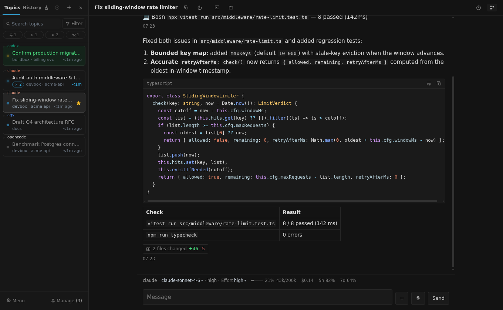

# 网页端

[English](../web-ui.md) | 简体中文



守护进程自己提供的 VS Code 风格工作台，默认采用 VS Code Dark Modern / Light Modern 配色。
不用注册机器人、不用账号、不依赖任何外部服务——这是把网关跑起来最快的方式，也是唯一一个完全不需要聊天平台的入口。

```yaml
platforms:
  web:
    type: webui
    token: ${WEB_TOKEN}       # 必填：登录页要输的共享密钥
    host: 0.0.0.0             # 默认；想只走 SSH 隧道就填 127.0.0.1
    port: 8787                # 默认
    title: Chat               # 默认；浏览器标签页标题

access:
  allowFrom: ["web:owner"]    # 身份恒为 <实例 id>:owner
```

打开 `http://<host>:8787`，输入密钥，就得到和其他平台一样的会话：流式回复、工具
气泡、`/model` `/effort` `/cd` 按钮菜单、`ask` 提问、附件上传与下载。菜单排成
网格、当前选项高亮，一页放 24 个（聊天平台是 12 个）。`/setting` 不再往聊天里插
消息，而是一个独立设置页：点击左侧导航条底部的 **Settings** 图标即可打开它，直接输入 `/setting` 也一样。

**工作台布局。** 页面采用插件化工作台结构（内置 12 个功能插件：话题列表、对话编辑、历史、定时任务、自动复盘、技能、设置、Git 改动、文件浏览、终端、文件预览、状态栏）：

- **左侧导航条（Activity bar）**：切换主侧栏视图，依次为 **Topics**、**History**、**Scheduled**、**Reviews**、**Skills**，以及固定在底部的 **Settings**。
- **主侧栏、编辑区、副侧栏与底部面板**：列表位于主侧栏；对话、设置、技能、历史只读视图、文件/Diff 编辑器与文档预览在中间编辑区打开；话题级 **Changes** 与 **Files** 停靠在右侧副侧栏；每话题独立的 **Terminal** 停靠在可调高的底部面板。
- **底部状态栏（Status bar）**：展示连接状态、运行中/闲置智能体数量（点击可 **Close idle**）、插件异常提示、**Notifications**、**Low attention**、**Language**（`English` / `简体中文`）、**Theme**（`System` / `Dark` / `Light`，VS Code Dark Modern `#1f1f1f` / Light Modern `#ffffff`）及版本号。
- **三档响应式宽度断点**：桌面端（`≥ 1024px`）展示完整三栏工作台并在编辑区过窄时自动折叠主侧栏；平板端（`640–1023px`）将左右侧栏切换为抽屉；手机端（`< 640px`）切换为逐页式外壳（底部 4 个主导航标签，其中「更多」汇集复盘、偏好建议、技能、设置、本设备开关与网关状态；话题详情顶栏展示状态点、智能体、目录、返回未读数与 `⋯` 菜单；话题行支持左滑操作与长按底部面板，以及话题内工具切换）。
- **拖拽分屏、视图移动与布局记忆**：桌面端（`≥ 1024px`）可将任意编辑器标签拖到编辑区左/右/上/下边缘实现分屏，或在常驻编辑器标签条内拖动重排（按 `Esc` 取消拖拽）。主侧栏、副侧栏与底部面板中的视图支持跨区拖拽，或通过各区标题栏的 **⋯**（移动视图）菜单在三区之间移动。布局状态自动保存在本机浏览器（`localStorage['aa_layout']`），刷新后自动恢复，数据损坏时自动回退默认布局。平板端（`640–1023px`）禁用分屏但保留标签重排。
- **布局快捷键与重置布局**：`Ctrl/Cmd+\` 向右分屏，`Ctrl/Cmd+1/2/3` 聚焦第 1/2/3 编辑组，`Ctrl/Cmd+B` 切换主侧栏，`Ctrl/Cmd+Alt+B` 切换副侧栏，`Ctrl/Cmd+J` 切换底部面板；执行「重置布局」（`workbench.action.resetLayout`）可清除已保存布局并恢复默认排布。

设置页是一列分组，每项用适合它的控件就地修改：开关类是
开关，短列表是分段按钮或下拉框，智能体是按机器分组的卡片，每个一张，上面是 harness（每种一个颜色）、
模型和权限等级。点一张卡片展开：模型显示完整模型名、点开是该智能体的模型列表（任何智能体都行，
不管它在不在跑），列表上方的输入框可以筛选，也可以直接用列表里没有的名字；权限等级并排列出、
下面一行写选中的等级是什么意思，选中即写入；打开指令编辑器后，还列出它会读的所有文件——共用的和
它自己的。斜体的值表示没设置，显示的就是实际生效的值。每次改动的
结果显示在横幅里，被拒绝时写明原因。页面顶部写明这些设置存在
config.yaml 里、对所有话题生效 —— 没有一项只属于当前话题；当前话题正在用的智能体标着
*this topic*，切换话题时页面自动关掉。你输入的命令仍留在聊天里，设置页不会。详见
[设置](settings.md)。

**切换模型。** 输入框上方的状态栏写着智能体和它的模型，模型本身是个按钮：点开是当前话题的智能体
能用的模型，正在用的带勾、该智能体的默认模型带 default 标记，列表长时可以筛选。点一个只切换当前话题
—— 等同于输入 `/model <id>`，之后再输 `/model` 看到的也是它 —— 不改 config.yaml；每个智能体的
默认模型在 **All settings** 里改。还没起会话的智能体会先启动起来再问（一两秒，期间有提示）；
harness 不提供模型选择时会直接说明。话题一有智能体，这个按钮就在 —— 在新话题的列表里选完智能体
就出现，所以第一条消息就能发给想要的模型；第一条回复之前状态栏只写 *Model*。选择跟着话题走，
`/new`、`/cd` 和重启之后都还在。

**智能体自己的设置。** 智能体可以在模型之外提供它自己的设置（比如网页智能体用哪个账号），每项在模型
按钮旁边各有一个同样的按钮，写着设置名和当前值。点开是这项设置的可选值，智能体对某个值的说明显示成
第二行小字（额度用完的账号会写明），点一个只改当前话题。能不能改、什么时候能改由智能体决定：它只给出
一个值的设置画成暗的、点不了（悬停看原因）；它拒绝的修改，列表不关，直接显示它给的理由。新话题里选完
智能体、发第一条消息之前，按钮就会出现 —— 像账号这种设置，这正是还能改的时候。网关不记这些设置：
智能体自己记，`/new` 和 `/cd` 之后的新会话又回到智能体的默认值，所以先选目录再选账号。只有网页端显示，
也没有对应的命令。

**状态行切换权限。** 输入框上方的状态行在模型与智能体设置旁边还会显示当前话题智能体的权限等级 chip，
点击即可在弹层里直接切换权限等级（如 `ask` / `auto` / `full`），不必离开当前对话。

**话题。** 左侧边栏列出并行的会话、在它们之间切换，和 Telegram 的论坛话题、飞书的话题群是同一种
形状：每个话题有自己的 agent session、自己的上下文，并且会根据聊下来的内容被自动命名。
回答这个话题的智能体压在这一行边框的左上角，颜色按它的 harness 区分——只写 id，因为机器名在下一行——鼠标悬停能看到完整 id；标题行只放标题。
点 `+` 新建；agent 自己也可以用 `fleetherd create-thread` 开一个，用
`--channel main/<话题 id>` 往指定话题里写。每个标题下面是这个话题的工作目录；智能体跑在
[远程主机](remote-hosts.md)上时前面还会带上机器名（`devbox · fleetherd`），鼠标悬停能看到完整路径。
这一行的最右端是时间：话题正在运行时显示已经跑了多久（`3m`、`1h`、`1d10h`，蓝色），
结束后显示距上一轮结束多久（`12m ago`，灰色）；悬停能看到具体时刻。还没说过话的新话题不显示。
网关连不上的机器会在这里、新话题里它那组智能体的标题上、以及输入框上方标出来（见[主机离线时](remote-hosts.md#主机离线时)）。
每行末尾的 **⋯** 按钮（悬停或键盘聚焦时出现，触屏上常显）打开这个话题的菜单，不会切换话题：
**Star**/**Unstar**、**Copy reference**（复制 `<标题> (<实例>:main/<id>)`，方便粘给别的会话里的智能体用 `fleetherd sessions read` 查阅）、**Fork**（把会话复制成旁边的新话题，见 [`/fork`](chat-commands.md#分叉话题fork)）、**End agent**、**Delete topic**（红色，确认框和以前一样）。**End agent**
点下去就结束这个话题以及它下面所有子代理话题的进程，不再二次确认——有子代理时这一项会写成
**End agent + N sub-agents**，按之前就能看到它管到哪；正在跑的一轮会就此打断。所有会话都保留，下一条消息接着来。
加了星标的行不悬停时仍会在行尾亮一个实心星：那是标记，不是按钮。
拖侧边栏右边缘可以调宽窄，宽度记在这个浏览器里；双击边缘恢复默认。窄屏上它会变成抽屉。列表上方的搜索框和
**Filter** 可以收窄它：搜索逐词匹配标题、智能体、目录名、完整路径和主机；搜索框下面是常驻的四个状态筛选
（Needs you、Running、Idle、No agent），**Filter** 里是其余筛选（星标、智能体、主机）——同组多选取并集，
组间取交集；栏太窄放不下状态文字时，只留图标和数字，完整名称在悬停提示里。筛选的单位是整个会话：根话题和它下面的
所有子代理算一棵，任一命中就整棵留下，渲染和不筛选时完全一样——折叠和折叠计数、needs-you 置顶和分隔线、排序、星标都不变，
也不会变暗。chip 上的数字和 **Showing N of M** 都按会话计数，一棵算一个；**Clear** 恢复整个列表。
关键词和筛选都记在这个浏览器里。标题栏里的 ×
在任何宽度都能收起它，右侧旁任务面板用的是同一个 ×：两边本来就是同一个组件，头部、底栏、滑动动画和
那层变暗的遮罩都一样。

**选择智能体。** 配置了不止一个智能体时，新话题会按机器分组列出所有智能体：每张卡片写着智能体的 id、
它是什么（Claude Code、Codex、OpenCode、Antigravity，自定义智能体则是它的命令名），设了模型的还会写上
模型。点一张卡片即发出 `/agent <id>`（输入框里已写的草稿不受影响），随后出现和 `/cd` 相同的文件夹选择器
（支持面包屑、上一级和筛选）来选工作目录；状态行随即可以切换该智能体的模型和设置项（如账号）。也可以
直接打字——标着 **default** 的那个智能体会回答。话题里一有消息，卡片就会消失。

**停下来。** 回复正在流式输出时，Send 旁边的 **Stop** 结束这一轮（`/stop`）；一轮结束后智能体因为后台任务
完成而回来继续干活时，话题同样显示为运行中，Stop 也能把它停下。话题背后有
智能体进程在跑时，标题旁的电源按钮结束这个进程（`/kill`）—— 会话保留，下一条消息接着原来的
继续。两个按钮都只是替你发出对应命令，输入框里写了一半的草稿不受影响。

**窄输入区。** 输入区自身窄到放不下输入框和按钮时，自动分为两行：输入框在第一行占满整行宽度，第二行左侧放置文件上传与语音录制按钮，右侧放置 Stop 与 Send 按钮。判断用的是输入区自己的宽度：输入区到 480px 及以下就分两行，侧栏为默认宽度时相当于窗口 641–752px（也就是话题栏仍占一列、输入框最窄只剩 213px 的那段），把侧栏拖宽的桌面窗口同样会分两行；手机上（640px 及以下）一直是这个布局。

**关闭待机中的智能体。** 一轮结束后，智能体进程会一直留着，直到守护进程按空闲超时把它回收（话题前的
暗蓝点）。点击底部状态栏里的 **Idle** 计数项即可一次全部关掉：先列出将要关闭的话题让你确认，
关完再逐个告诉你结果。会话都保留，话题里的下一条消息会让
智能体从原处接着来。确认期间开始干活的话题不会被关；星标话题和其他话题一样会被关闭。**Clear all topics**
是话题栏顶部 Topics 标题旁的图标按钮。它旁边的 **Mark all read** 一键清掉话题列表里所有未读标记，并告诉守护进程那些没看过的完成回复已经看过，和 Sessions 小标签的按钮对定时运行做的一样；没有可标记的内容时它是灰的。

**旁任务。** 聊天标题栏右侧的时钟按钮打开一个面板，底部有两个标签页：**Scheduled** 和 **Reviews**。**Scheduled** 内部再细分两个小标签：**Tasks**（默认）列出网关登记的所有任务——执行什么、下次什么时候跑、结果发到哪里、上次跑得怎么样，列表上方的搜索、**Filter** 和排序可以收窄和重排它：搜索匹配任务名、提示词或命令、以及目标；搜索框下面是常驻的四个 **Status**（Running、Active、Paused，以及把 expired 和 done 合在一起的 Ended），**Filter** 里是 **Tags**（正在用的每个标签加 **Untagged**）；排序可在 **Status**（默认）、**Next run**、**Last run**、**Created** 之间切换，可升可降，没有对应时间的任务始终排在最后。关键词、筛选和排序都记在这个浏览器里，**Showing N of M** 和 **Clear** 说明筛掉了多少；**Sessions** 列出「新会话」型任务每次运行开出来的话题——这些话题不再混在普通话题列表里，所以这里就是它们的位置，点一下直接打开（行尾的 ⋯ 和侧栏话题行一样，有 **Star**、**Copy reference**、**Fork**、**End agent** 和 **Delete topic**）。运行派出的子代理挂在那次运行下面，和话题的子代理一样收在计数小标签后面，不出现在话题列表里。列表按时间分组：本月的按天、更早的按月，每组单独折叠，折叠状态记在这个浏览器里——最新一组和当前打开话题所在的组默认展开，折叠的组头会汇总组内未读数和仍在运行、等待回答的数量。打开 Sessions 时，面板标题栏的勾选图标 **Mark all read** 一键清掉所有会话的未读标记，并告诉守护进程那些没看过的回复已经看过。**Reviews** 列出对闲下来的对话做的自动复盘（见[技能](skills.md#自动复盘)）：每次改了什么、技能库拒绝了什么和原因、注意到的偏好建议，以及撤销每项改动的命令；点开复盘详情可看到复盘智能体、模型、消息数、耗时与技能改动的内联 diff，并可直接点击 **Revert**（带确认框）一键回滚已应用的技能提交。什么都没改的复盘不会在任何地方发消息，所以这个标签页是它唯一的去处。复盘列表上方的 **Suggested preferences** 汇总还没处理的偏好建议（多次复盘提过的合成一条），每条有 **Adopt** 和 **Dismiss**：Adopt 新开一个话题，输入框里放一段草稿，请 agent 把这条建议加进你的指令——不会自动发送，你可以先改草稿、先 `/agent` 换人，或者直接放弃；只有该话题里一条仍带着这条建议的消息真正发出去，它才会从列表消失。Dismiss 只是把它从列表里去掉，不做别的事。
如果有运行（或它派出的子代理）在等你回答，时钟按钮、Scheduled 标签页和 Sessions 小标签上都会出现一个琥珀色小点——它在话题列表里没有行，这是面板上的明显提示。面板在宽屏上是右侧的一列，和左侧话题栏是同一个组件，只换了贴的边；
头部、底栏、×、滑动动画和遮罩都一样，不一样的只有默认宽度和「多窄开始变抽屉」这个断点。1024px 以下它是从右边滑入的
抽屉，最多占 88% 宽，左边还留一条聊天，点变暗的聊天区域就能关掉；640px 以下左侧话题栏也是同样宽度的抽屉。默认关闭；
只有宽屏上停靠的面板会在刷新后恢复，窄屏每次都从时钟按钮打开。宽屏上它比话题侧栏更窄，拖左边缘可以调宽度，双击边缘
恢复默认。任务本身画成和话题行一样的行：状态圆点、名称，下面一行是它正在做什么（倒计时、`running now` 或状态词）、结果发到哪里、上次跑得怎么样（非 ok 标红）和标签。cron 表达式、下次运行的具体时间、目标全称和运行模式在行的悬停提示里，也在点开的任务页里。任务页上还有完整的提示词或命令、标签编辑（点标签上的 × 删除，在 **+ tag** 里输入后按回车添加）、这个任务的运行开过的话题，以及最近的运行记录，每条都能跳到它投递的话题；页上的 **Edit** 可以直接修改任务，见[定时任务](scheduled-tasks.md)。行的 ⋯ 里是 **Pause** 或 **Resume**、**Run now** 和 **Edit**（运行中都置灰并说明原因）以及 **Delete**，删除像删话题一样只确认一次。
面板标题栏的 **+** 用和 **Edit** 同一张表单新建任务——也可以照旧在话题里让智能体登记。

**需要你的事。** 所有在等你的话题会移到列表最上面，标题变绿，下面有一条分隔线：先是要你回答的问题（琥珀色圆点），
再是失败的一轮（红色圆点），然后是你还没看的回复（绿色圆点）。鼠标悬停能看到是什么事，回复显示第一行，通常就是结论。
回复在你看过之后回到原来的位置。失败会一直置顶，直到下一轮开始，之后圆点仍保持红色。

子代理话题不算在内：它做完的回复和失败是开它的那个智能体要处理的事，所以不会置顶，做完的一轮也不亮
绿点，圆点保持普通的空闲/在线灰色；它的提问（琥珀色）和干活（蓝色）不变，等你去读的是主智能体那条话题。

这一组下面，还没有标题的新话题排在最前——新开的对话就是你正要开始的地方——其余按状态排序：运行中、智能体在但不干活、没有进程。
新话题选完智能体后弹出的目录菜单不算在内：那是你自己下一步的选择，没有智能体卡在上面等你，所以选到一半
放下的话题既不会置顶，也不会推送通知。
[子代理](sub-agents.md)的话题折叠在开启它的话题下面（点数字展开）；子代理还在干活时，父话题本身也显示为运行中，
即使它自己这一轮已经结束。只有子代理自己提问时才会置顶，其余的由派活的智能体去读。
回复里指向某个话题的链接会在当前页面直接打开它。

**低注意模式。** 好几个智能体同时干活时，列表会一直在动：每个运行中的话题圆点都在闪，未读数也在蓝底白字的
气泡里随每条消息往上跳。在底部状态栏打开 **Low attention** 就不会了：运行中的话题圆点
仍是亮蓝色但不再闪，未读数变成灰色。等你回答的问题（琥珀色圆点照样闪）、失败的一轮、你还没看的回复仍然
置顶变绿，所以只有它们显眼。这个设置只存在当前浏览器里。**Theme**（跟随系统 / 深色 / 浅色，首绘前生效并同步代码视图高亮）、**Language**（English / 简体中文，免刷新即时切换）、通知开关与 **Close idle** 同样位于底部状态栏；**Settings** 与 **Skills** 位于左侧导航条，**Clear all topics** 则是左栏顶部 Topics 旁边的图标按钮。

**回复里的代码。** 每个代码块顶上有一条栏，标出语言，带 **Wrap**（长行在块内折行，不用横向滚动）
和 **Copy**（按原样复制代码，按钮会短暂变成对勾）。消息不再变化之后，代码按文件查看器同一套语法
上色；正在进行的一轮还在写的那条消息保持纯文本，等后面来了新消息或这一轮结束再上色。`diff` 或
`patch` 代码块在流式输出时就按行着色：新增行绿色、删除行红色、hunk 标题蓝色。缩进在列表项下面的
代码块按代码块显示，不再挤成一行行内代码。窄屏上表格在自己的框里横向滚动；单元格里 `` `代码` ``
中的 `|`（或写成 `\|`）不再把单元格切开；`- [ ]` / `- [x]` 显示成未勾和已勾的方框——只读，因为在
这里勾选不会告诉智能体任何事。

**完整的工具命令。** 智能体跑的每个工具在工具气泡里占一行。聊天应用里一行只带命令的前 40 个
字符（`tools.previewLimit`），这里带整条命令（最多 2000 个字符）。行在气泡边缘处截断，屏幕宽
就多显示一些；行尾的 ✓ 和耗时始终看得见。点一行展开全文，再点一次收起；气泡下方的
**Show all** 展开所有行，按下之后智能体新加的行也是展开的。

**子代理消息。** 关于子代理、而不是智能体回复的气泡，顶部会标出 **Sub-agent task** 或
**Sub-agent report**，并配一条自己的颜色竖线。派发类包括：请你确认启动子代理的卡片、启动后的
记录卡片，以及子代理话题收到的任务文本（以 `↳ From …` 开头的那条，以及之后每次 `task-send`
发进去的消息）。汇报类就是派活的话题收到的可折叠 `🔔` 卡片——每个子代理一行，折叠和展开都和
工具气泡一样；`task-send --forward` 带进话题的那段回复也算汇报类，同样一行一行折叠。标记随消息
一起保存，刷新页面和网关重启后都还在；聊天平台看到的仍是原文，不带标记。

**旁支提问。** [`/btw`](chat-commands.md#旁支提问btw) 的问题和回答都不进聊天记录，所以回答夹在一段还在
流式输出的回复中间，也不会被读成那段回复的下一段。提问的位置只留一行——**BTW**、问题本身、*Waiting…*
或 *Answer*——回答显示在输入框上方的卡片里：问题一发出卡片就打开，回答边写边更新。点 × 或按 Escape
收起卡片（这个回答后面的内容到了也不会再弹出来），点那一行可以重新打开。这个版本之前的回答，或者问题已经
不在话题里的回答，仍然画在聊天记录里，标为 **Side question**，配一条虚线竖线。

**图片。** 粘贴截图（Ctrl-V）或者选一张图片附上，输入框里会显示缩略图，带一个 × 可以从这条消息里
拿掉。发出去之后，你的消息里也显示这张图，点一下全屏查看。守护进程只在运行期间保留这份副本：重启
之后，重启前的消息只留下图片的文件名，不再显示图片。

超过 300 KB 的图片会先在浏览器里压小再发：画面限制在约 300 万像素（4:3 即 2048×1536，正好是
模型看图用得上的量；长图另加 4096 像素的单边上限），质量取仍能压进 300 KB 的最高一档。手机拍的
照片上传快很多，智能体看到的仍是完整的画面；常见手机截图保持原尺寸或接近原尺寸，文字不会明显
变小。JPEG、PNG 和 HEIC 在浏览器能写 WebP 时都转成 WebP，不能时用 JPEG；GIF 保留动画原样发送，
浏览器解不开的图片也原样发送。重新编码会去掉相机写入的 EXIF 信息，包括拍摄地点。

**不用下载就能看文件。** 智能体发来 Markdown、日志、CSV 或源代码文件时，点文件名就会在对话上方
弹出一个窗口直接阅读，旁边的 **Download** 按钮仍然负责下载。Markdown 按回复的样式渲染，标题、
表格、代码块都在；其他文件在带语法高亮的代码视图里打开，有行号，手机上自动折行（浏览器没加载到
编辑器时退回纯文本）。`.html` 和 `.svg` 只显示源码，绝不会运行。超过
512 KB 的文件只显示前 512 KB 并注明，窗口栏里的 **Download** 链接可以下载完整文件。PDF、
Office 文档和其他二进制文件没有预览，仍然只能下载。和下载链接一样，预览只在守护进程这次运行
期间有效；重启之前的消息只保留普通的下载链接。

**为弱网写的。** 回复是在内容稳定后才发，而不是流式的每一次刷新都发；线路上的东西全部压缩；
断线重连从断点续传，而不是重新下载整个会话。一次 30 秒的流式回答，13 次更新被压成 3 次，
字节数大约是原来的四分之一。页面本身每个版本只下载一次：之后刷新只问守护进程「变了没有」，
没变就直接用浏览器里那份，升级后的第一次刷新会拿到新页面。切到后台的标签页 15 秒后停止接收，
切回来时立刻补上这段时间的内容；切回刚离开的话题，也只下载离开之后的新内容。所有需要你处理的话题——侧栏里的
绿色话题，以及跑完或在提问的定时任务和子代理——都会在你打开之前按侧栏顺序在后台预载，并保存在浏览器里，
点过去立刻显示最新状态；刷新页面后也一样，你中途切走、之后才跑完的话题也一样。之后话题里有任何变化（包括
修改消息）都会重新拉取。附件按原始字节上传，不再编码成大三分之一的文本。发送带 nonce，所以页面可以放心重试。一次发送如果完全没有回应，
消息不会一直灰着：15 秒后（带大附件时更长，最多 5 分钟）它会变红，并给出 **Retry**、
**Copy**、**Discard**。超过这个时间还是灰色的，就说明这条消息没有离开浏览器。

**断线不会弄丢你打的字。** 消息在你点发送的那一刻就记在浏览器里，直到守护进程确认收到才删掉。
所以刷新页面——包括 Cloudflare Access 会话过期后不得不做的那次刷新——之后它还在，排在对话最下面，
不会丢。如果页面在守护进程回话之前就关了，这条消息会标明「未确认」，等页面核对过再说；确认守护进程
没收到，它就变红并给出 **Retry**。刷新后的 Retry 只对纯文本有效；带了文件的消息只给 **Copy** 和
**Discard**，因为文件本身没有保存下来。输入框里的草稿也会在你停止打字一秒后保存。

## 技能

话题列表底部 **⚙ Menu** 里的 **Skills** 打开网关自己维护的技能——也就是下发给每个智能体的那些
（见[网关自己维护的技能](skills.md)）。页面列出每个技能的状态（在用、过期或已归档）、是否钉住和最后使用时间。
**New** 新建；点开一个技能能看到它的文件、`SKILL.md` 编辑器和每次改动记录；**Delete** 是归档而不是删除，
**Restore** 可以拿回来。保存 `SKILL.md` 会带上页面读到的版本号，别处改过就会拒绝而不是覆盖。
页面和 `fleetherd skills` 写的是同一套存储；从这里归档，同样会通知创建这个技能的会话。

要让智能体用上某个技能，在对话里说的就是它的名称，所以列表每一行和技能自己的页面上都有一个复制按钮。
窗口会在当前浏览器里记住上一次画出的列表：下次打开立刻显示，同时在后台再问一次 daemon，只有结果变了才重画；
后台刷新失败不出声，标题栏右上角的刷新按钮手动再问一次，失败会说。在技能页里，这个按钮还会重新读取
这个技能——但编辑器里有没保存的内容时不会动它。

## 改动

对话页面顶部的分支图标，打开这个工作目录所在仓库的改动。它是只读的：列改动、看 diff、把评论带进输入框；
这里不暂存、不提交、不丢弃——智能体通常正在同一个仓库里干活。

标题栏有三种对比，另外还有提交历史。**Working** 是工作区对 `HEAD`，含未跟踪文件；**Branch** 是工作区对
`HEAD` 与某个 base 分支的 merge-base，已提交和没提交的改动一起看；**Committed** 是 `HEAD` 对同一个 merge-base。
base 默认取仓库的默认分支（`origin/HEAD`，再退到 `main`、`master`），可以在下拉框里换。没有提交的
新仓库也能用。所有路径都相对仓库根目录，即使话题的工作目录只是仓库的子目录。智能体刚建出来的目录会按文件
逐个列出；未跟踪文件多到没有全部统计时，那一行会写「行数未统计」，而不是显示一个没量过的 `+0 −0`。

**Commits** 列出提交历史本身：每条显示短 sha、标题、作者和多久以前。**Load more** 往前翻页。
点开一条会显示它的说明（正文默认折起，需要时展开）和它改动的文件；**← Commits** 返回列表，
**Refresh** 重新读列表。在提交里打开的文件按那个提交读，不是工作区；在它上面写的行评论会在
文件名和行号后带上短 sha，智能体就不会当成是对当前文件的评论。base 下拉框只属于那三种对比，
**Commits** 里不显示。

某种对比为空时，窗口中间会写清是哪一种、跟什么比的，并给出 **See commits** 直接切过去，
而不是让右半边空着；目录不在仓库里时同样在中间说明，而不是显示成一次失败的请求。
桌面宽度下，对比列表会自己打开第一个文件；本轮改动和手机上的列表都等你来选——手机两栏
是上下叠的，自动打开会把列表顶出屏幕。

点一个文件看它的 diff，标题栏的按钮可以在单栏和并排之间切换，手机默认单栏。在 diff 里选中几行会出现
**Comment**；文件名、行号范围、选的是旧侧还是新侧、选中的代码（放在代码块里）和你的评论会插进输入框，
你可以改完再发送。多条评论会依次累加。窗口里不会发送任何东西。浏览器拿不到代码视图时，退路是按 +/−
上色的纯文本 patch，这种模式没有行选区，所以不显示 **Comment**。

话题的 turn 结束时列表会自动刷新，跟上智能体刚做完的改动。页面同时有文件编辑器时，每个文件行会多一个
**Edit**，按绝对路径打开那个文件。编辑器自己还有工作目录限制，话题目录之外的文件仍可能被它拒绝。

## 历史

话题列表顶部有两个标签页：**Topics** 和 **History**。History 列出网关记录过的全部对话——不分智能体和平台，
和 `fleetherd sessions list/search/read` 读的是同一个库。复盘自己的会话不在这里，在侧栏的 Reviews 里。每条历史行（以及聊天标题栏查看当前话题或历史会话时）都带有一个复制按钮，可一键复制 `<标题> (#<id>)` 或 `<标题> (<实例>:main/<id>)`，方便直接把会话引用粘贴给智能体查阅。

一行显示标题、智能体、平台、最后活动时间和消息条数。**Load older conversations** 继续往前翻，
库记录到多早就能翻到多早。在搜索框里输入后按回车，一次搜遍所有对话；清空输入框就回到列表。
每次切到这个标签页都会重新读一遍列表。

点一行，这段对话就在平时看话题的地方打开，样子也一样：你的消息、带格式的回复、折叠成行的工具调用。
它是只读的——输入框换成一行说明，讲清为什么发不了：这段对话可能跑在别的平台上，或者它的话题已经从本页清掉。
如果它在本页还是某个话题，会给出 **Open the topic** 跳过去。太长的对话在 500 条处截断，说明就在最后一条旁边：
你看到的是这段对话的一部分，不是全部。库里存的比话题里少——连续的工具调用合成一行，没有按钮、图片和耗时。

点 **Close**、切回 **Topics** 标签页、或者打开任何一个话题，都会回到原来的话题、原来读到的位置。
手机上点开一段对话会收起抽屉；再打开抽屉点 **Topics** 就回去了。标签页和打开的对话都不记忆：刷新后回到
Topics，停在地址里的那个话题。

## 本轮改动

话题的工作目录在 git 工作树里时，每一轮都会记下它改了什么：发出 prompt 之前存一次工作区快照，这一轮结束时再存一次，
回复末尾因此多出一行——`3 个文件 +12 -4`。没有改动的一轮不会多这一行。
点它会打开那一轮的改动，在 git 窗口里按文件查看；
从"有东西变了"到"是哪个文件"就靠这一下。

快照是网关自己的，放在跑智能体那台机器的 `~/.fleetherd/snapshots/<仓库根路径的哈希>` 下，
项目自己的 `.git` 一概不碰。`.gitignore` 仍然决定快照收哪些文件，例外是 git 自己的规则：
快照已经记过的文件，之后被忽略也仍然在里面。每个话题保留最近 50 轮，重启后还在；
更早的记录会删掉，它们背后的对象也会定期清理。

开始快照最多等 3 秒。超时或失败只是这一轮没有入口，绝不会拖慢或弄坏这一轮本身。
只有 webui 上的会话会记录：聊天平台的回复没地方放 diff，不在 git 工作树里的目录也没什么可比的。

**同一个目录**里两个话题同时跑时，这一轮的 diff 会混进另一个话题的改动：它比的是"我的 prompt 之前"和
"这一轮结束之后"的工作区，中间别人改的也在里面。同一个项目上同时开两个话题，是这里唯一分不开的情况。

## 通知

话题列表底部 **⚙ Menu** 里的 **Notifications** 为这台设备打开推送通知。浏览器会请求一次权限，
之后即使页面关着、手机锁着屏，也能收到通知。点通知会打开对应话题。通知到达时就会把这个话题
拉到浏览器里，点开时回复已经在了。

什么时候通知：任何话题开始需要你时都会通知；子代理的话题只在它自己提问时通知。发生时你正在看的话题不会通知。
每个想收通知的浏览器各自打开一次，关的时候也一样。

- 桌面和安卓上的 Chrome、Edge、Firefox 都支持。iPhone 和 iPad 要先**添加到主屏幕**
  （iOS 16.4 及以上），并从主屏幕图标打开。
- 页面必须通过 HTTPS 访问（或者 `localhost`）。局域网里普通的 `http://` 地址无法请求通知。
- 通知经过浏览器厂商的推送服务（Google、Mozilla 或 Apple），网关要能通过 HTTPS 访问到它。
  内容是加密给你这台设备的，而且只有话题名和一行字。
- 密钥和设备列表保存在 `~/.config/fleetherd/webui-push-<instance>/`。删掉这个目录会忘掉所有设备，
  每台设备都要重新打开通知。

## 终端

打开之后，聊天页顶栏会多一个 `>_` 按钮，在聊天页底部开出一个守护
进程所在机器的真终端——于是**任何** coding agent 的 CLI，连同它的 TUI，都能在同一个页面里
直接跑。它是一条停在对话下方的面板，默认占聊天区一半高：聊天记录和输入框都还在、都能用，
上面的分隔条可以拖到任意高度（方向键也行，双击回到一半），这个高度记在浏览器里，刷新后
还在。它是**每个话题一个面板**，右上角两个按钮是两件不同的事：最小化只是收起来，里面
跑着的东西照常跑、连接也不断——切到别的话题再切回来，还是同一个终端，不会重连；关闭才是
真的结束这个会话。话题列表会标出哪些话题开着终端。守护进程自己不实现终端：它只是把请求
过同一道登录门之后，转发给你自己跑在 unix socket 上的
[`ttyd`](https://github.com/tsl0922/ttyd)。默认关闭，要自己打开。

```yaml
platforms:
  web:
    type: webui
    token: ${WEB_TOKEN}
    terminal:
      enabled: true
      socket: ~/.config/fleetherd/webui-term-web.sock   # 你的 ttyd 监听在哪
      # 可选：怎么「结束一个会话」。不配的话窗口上就没有关闭按钮，只有最小化——
      # 因为会话能在断线之后活下来是你那边的安排，不是这个守护进程的。
      # 是 argv 数组，不是 shell 字符串。
      endCommand: ["tmux", "-L", "aa-web", "kill-session", "-t", "aa-{topic}"]
```

```bash
# 另一半不归这个包管。wrapper 里要套一层 tmux——否则关掉标签页，
# 里面正在跑的东西会跟着被 SIGHUP 掉。
printf '#!/bin/sh\nexec tmux -L aa-web new -A -s "aa-$1"\n' > /usr/local/bin/aa-terminal.sh
chmod +x /usr/local/bin/aa-terminal.sh
ttyd -i ~/.config/fleetherd/webui-term-web.sock -b /term -W -a -O \
     -T xterm-256color /usr/local/bin/aa-terminal.sh
```

## 文件

打开之后，聊天页顶栏会多一个文件夹按钮，打开的是这个话题的 agent 所在机器上的文件浏览器和
编辑器——本机或远程主机，跟着话题走。左边是按需展开的目录树（手机上是抽屉），右边从上到下是
面包屑、按文件名搜索、和文件本身。目录位于 git 仓库内时，文件树上的改动项会显示 git 状态角标
（如 `M`、`A`、`?`），方便浏览时直接辨认未提交改动。1 MiB 以内的 UTF-8 文本可以直接改；图片（PNG、JPEG、GIF、
WebP，最大 5 MiB）直接显示，其他文件（二进制、不是 UTF-8、或者超过上限）只给一句说明，讲清为什么
不能在这里编辑。Markdown 多一个「预览」页签。

默认关闭，理由和终端一样：一次保存就是在同一台机器上写文件，等于换条路执行命令。它能碰到的
范围是每个话题的工作目录、这个目录所在的 git 仓库，加上 `roots` 里列的目录，别的一概不行。路径会先规范化再判断是否落在
这些目录之下，用 `..` 往外爬会被拒绝。**这些目录里的符号链接会被跟随**，所以链接指向哪里，就能
通过它改到哪里；这是有意的，因为工作区本来就常常由指向各个卷的链接组成，但也意味着 `roots`
就是这个功能的边界。上限和 agent、终端相同。

每次保存都会检查版本：文件的大小、修改时间，或内容本身的 SHA-256 和你打开时不一致，编辑器就会
让你选重新载入、强制覆盖或取消，而不是悄悄盖掉别人的改动。检查在写入之前、以及替换文件之前各做
一次，但它是检查不是锁：两次保存恰好同时落下，仍然可能互相覆盖。保存会保留原文件权限，写到链接
指向的真实文件上而不是把链接换成普通文件，也不会动文件原有的 BOM，也不会动统一的 CRLF 或 LF——打开后原样保存，
字节不变。行尾混用、或者整篇只有 CR 的文件，编辑器没法原样保持：窗口会在编辑器上方写明保存时会统一成
哪种换行，而不是悄悄改掉。每次写入都会记一行日志：谁、哪台机器、哪个文件。新建、重命名、删除作用于编辑器里打开的那个
文件；目录行上还有自己的重命名和删除按钮。目录只有在空的时候才能删除——非空时窗口会明确说出来
并保持原样——删除打开文件所在的目录之前，会先问未保存的改动。

```yaml
platforms:
  web:
    type: webui
    token: ${WEB_TOKEN}
    files:
      enabled: true
      # 可选：除了自己的工作目录外，每个话题都能访问的目录。
      # 绝对路径，或者 agent 所在机器上的 ~/…
      roots:
        - /srv/shared
```

设置页还能在同一个编辑器里改所有智能体读的约束——网关上的和每个智能体在自己机器上的——用单独的开关
`instructions.enabled`，见[写给所有智能体的工作偏好](instructions.md#在-web-ui-里编辑)。

## 对外暴露

> [!WARNING]
> 默认监听所有网卡且是明文 HTTP，所以那个密钥就是你的网络和一个拥有完整工具权限的
> 智能体之间的全部屏障。要暴露到你掌控范围之外，先在前面加一层带 TLS 的反向代理；
> 或者设 `host: 127.0.0.1`，用 SSH 隧道访问。
> 如果确实过反代，务必**关掉响应缓冲**（nginx 里 `proxy_buffering off;`）——被缓冲的
> SSE 会让整轮回复到结束才一次性出现；开了终端的话还要放行 `Upgrade`/`Connection`。
> 另外：打开终端，等于把这个密钥从「守着一条和智能体的对话」变成「守着一个 shell」。
> 权限上限没变，但从密钥泄漏到任意命令的距离短了很多。

## 单点登录

一个共享密钥不够用的时候。共享密钥上没有名字、不会过期，也没法只
吊销某一个人。如果这个页面前面已经有一层认证代理——Cloudflare Access、Teleport 的
Application Service——那它已经认过「人」了（SSO + MFA），并把结论签成一个 JWT 带
过来。把 `sso:` 指向这个代理的公钥，守护进程就去验这个签名，而不是再问一遍密码。

```yaml
platforms:
  web:
    type: webui
    token: ${WEB_TOKEN}
    sso:
      # 这里是 Cloudflare Access。Teleport 换成：header Teleport-Jwt-Assertion、
      # jwksUrl https://<proxy>/.well-known/jwks.json、claim username。
      header: Cf-Access-Jwt-Assertion          # 默认值
      cookie: CF_Authorization                 # WebSocket 握手拿不到 header 时的那份
      jwksUrl: https://<team>.cloudflareaccess.com/cdn-cgi/access/certs
      issuer: https://<team>.cloudflareaccess.com
      audience: <这个应用的 AUD tag>           # 不是可选项：它挡住的是「同一个 IdP
                                               # 给另一个应用签的 token」
      claim: email                             # 默认值
      allow: ["you@example.com"]
      from: ["172.24.0.0/16"]                  # 只有代理，别的都不行
      password: false                          # SSO 跑通之后，把老门关掉
```

`from` 是必填的：签名本身已经让伪造请求头没有意义，`from` 保的是上面四个字段里写
错一个也不至于致命。被拒的请求会把来源地址打进日志——那行就是你该往 `from` 里填
什么的答案。`fleetherd doctor` 会去拉一次 JWKS 并报告拿到几把钥匙，**在设
`password: false` 之前先跑一次**：老门关掉之后，IdP 一挂就没人打得开这个页面了。

## 要有的预期

知道密钥的人共用同一批话题。守护进程重启不会丢掉话题里说过的话：任何话题一有变化，几秒之内守护进程就
把聊天记录写到自己的磁盘上，智能体的会话也存在磁盘上。所以重启或重建容器之后，每个话题在任何浏览器里
都会带着全部内容回来——包括你放下手机之后才答完的回复。重启前的消息在一条分隔线上方，分隔线注明它们来自
重启之前，智能体带着上下文在下面接着干。开着的页面不用刷新：守护进程停下时页面显示正在重连，回来后自动接上
并补齐话题；如果回来的是新版本，输入框上方会出现一行提示和 **Reload** 按钮，点了才刷新，不会自己刷掉你正在
写的东西。（2.13.0 之前只有星标话题这样保存；那时没加星的话题，只能显示你
的浏览器自己存下的部分，或者什么都没有。）**星标**话题（行尾亮着的实心星）不会为了腾位置被删掉，「Clear
unstarred topics」也不会动它。
